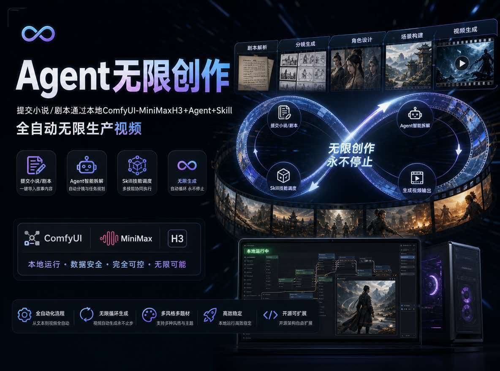
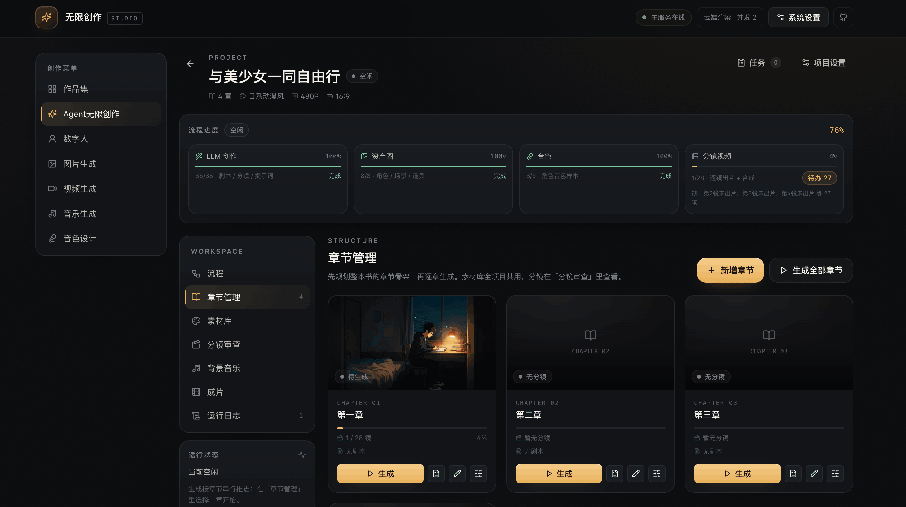
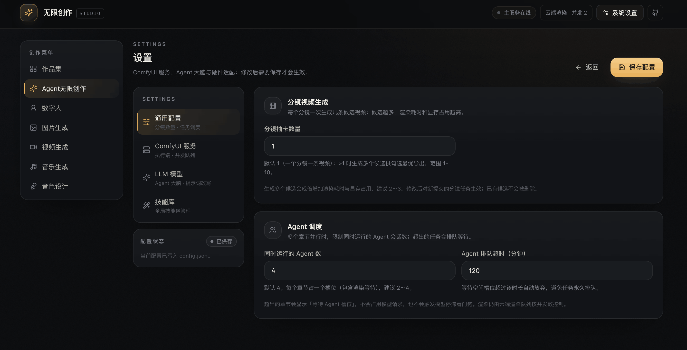
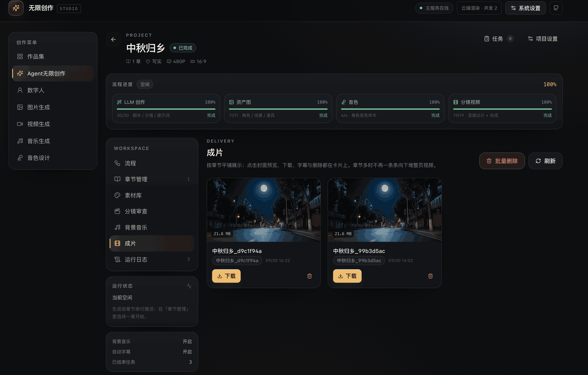
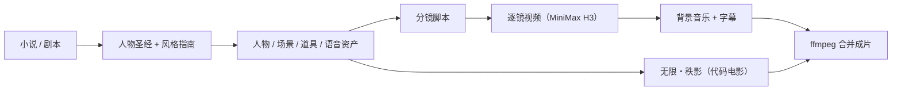
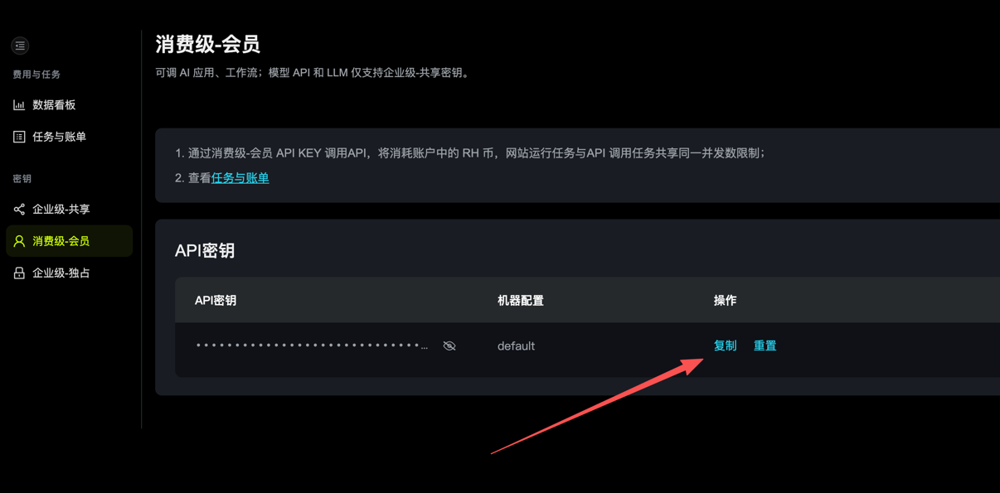
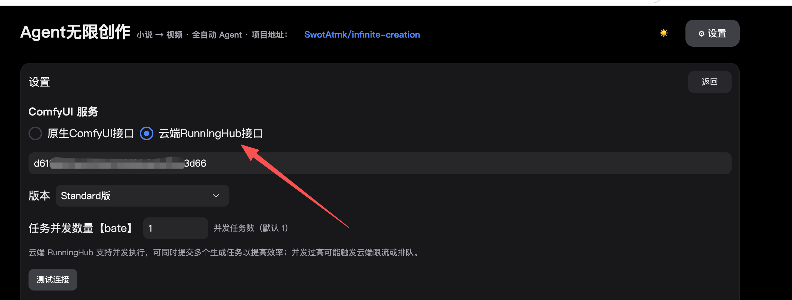

<div align="center">

# Agent无限创作 · 把你的故事变成亿帧画面

**免费开源本地 Agent 全自动视频生成 ✨**
上传小说 / 剧本，本地一键生成任意时长的成片，全程无人值守。

<a href="https://github.com/SwotAtmk/infinite-creation/stargazers"></a> <a href="README_EN.md"></a> <a href="https://github.com/SwotAtmk/infinite-creation/blob/main/LICENSE"></a> <a href="https://nodejs.org/"></a>

</div>

<p align="center">
  <a href="#快速开始"><strong>快速开始</strong></a>
  ·
  <a href="docs/technical.md">技术文档</a>
  ·
  <a href="#运行配置">运行配置</a>
  ·
  <a href="#交流群">加入交流群</a>
</p>

<p align="center">
  
</p>

## 赞助商

<table>
  <tr>
    <td width="200" align="center" valign="top">
      <a href="https://admins.taoxiangyoushu.com/#/register?code=FzH3DEp"></a>
    </td>
    <td valign="top">
      <strong>淘项有术：AI 综合应用服务平台</strong><br>
      聚合 AI 风口项目、副业轻创业社区与商业知识库等资源，帮助个人低成本上手 AI 项目、找到可落地的副业方向。<a href="https://admins.taoxiangyoushu.com/#/register?code=FzH3DEp">通过专属链接注册</a> 即可领取使用【7 天SVIP 会员】兑换码：TsHcxt0t
    </td>
  </tr>
</table>

如果你或你的团队认可这个项目，欢迎成为赞助商，让项目走得更远：

- 品牌 / 产品展示在本 README 顶部，随仓库被所有访客看到
- 可附一段产品介绍与官网 / 注册链接
- 赞助金额、周期与权益均可协商

**合作洽谈**：[swotatmk@foxmail.com](mailto:swotatmk@foxmail.com)（邮件标题建议注明「赞助合作」）

## 界面一览

<table>
  <tr>
    <td width="50%"></td>
    <td width="50%"></td>
  </tr>
  <tr>
    <td width="50%"></td>
    <td width="50%"></td>
  </tr>
  <tr>
    <td width="50%"></td>
    <td width="50%"></td>
  </tr>
</table>

## 案例

<div align="center">
  <video src="https://github.com/user-attachments/assets/3ace95ff-1ec1-46b0-abab-115c76734ee3" width="70%" controls></video>
</div>

> 《妈妈的时间》

<div align="center">
  <video src="https://github.com/user-attachments/assets/c415e1bb-ce1a-46fe-b97f-00362899eed3" width="70%" controls></video>
</div>

> 由体验官「闪电.」使用 infinite-creation 项目进行创作

[更多样例](docs/run_demo.md) · 「无限・秩影」内置样例位于 `public/samples/`，在页面右上角「预览样例」可直接播放成片、查看素材与提示词，并「一键试用」。

## Agent无限创作是什么

面向小说改编、漫剧广告与故事讲解视频的开源本地工作台。它把内容分析、资产管理、分镜、媒体生成、费用追踪和导出组织成一条可审核、可中断恢复的生产流水线，不需要演员、配音、导演和剪辑师。

- **两个创作工作台**：**Agent无限创作**（小说 / 剧本 → 长视频）与 **无限・秩影**（接入 lemo-opuscar 代码电影技能，66 个风格模板 + 任意素材 + 提示词，Agent 自动渲染风格化成片，无需 ComfyUI）。
- **统一生产链路**：小说或剧本进入项目后，自动完成人物圣经、风格指南、人物 / 场景 / 道具 / 语音资产、分镜脚本、逐镜视频、背景音乐、字幕与 ffmpeg 合片。
- **视觉一致、人工可控**：跨分镜复用 canonical 参考图与场景站位表，关键阶段可确认，单个分镜可重做，变更日志可回滚。
- **本地与云端都能跑**：本地 ComfyUI（12G+ 显存）或 RunningHub 云端算力；也可把流水线交给本机 CLI Agent，通过 MCP 工具桥接管。
- **交付可继续编辑**：自动字幕可开关（同时保留无字幕版本与 SRT），背景音乐库支持生成 / 预览 / 应用到多章节，成片支持单个或批量删除。

## 核心能力

- **无限视频时长**：支持生成任意时长的视频，无需手动调整分镜脚本或视频参数，上传小说/剧本自动生成长视频。
- **自动分镜**：根据人物动作、场景变化、道具移动等自动分镜，无需人工干预。
- **项目隔离**：每个项目的素材文件 + Agent 上下文（人物圣经/风格指南/连续性记录）完全隔离，资源按分类整理（人物/场景/道具/语音/音乐/音效/其他）。
- **人物一致性**：每人物一张 canonical 参考图跨分镜复用 + 统一外观描述 + H3 参考标签规则。
- **技能系统**：默认预装 MiniMax-H3 视频 Skill + 本项目 novel-to-video 主技能；支持把 SKILL.md 丢进 skills/ 目录扩展。
- **自迭代（技能工厂）**：上传一个新的 ComfyUI 工作流 JSON，自动解析节点 → 生成工作流规格 + 起草对应技能，Agent 立即可调用。
- **断点续跑**：任务持久化 + 幂等跳过，进程崩溃/重启后可继续，不重复生成。
- **审查/重生成**：分镜级预览与重生成（换种子 / 按反馈改写提示词）。
- **背景音乐**：视频阶段自动生成纯音乐背景音乐并合成到成片；另有「背景音乐库」支持手动生成（可填 caption/歌词/时长）、预览、选择，并一次性应用到多个已完成的章节。
- **自动字幕**：项目设置可开关「自动添加字幕」，设置页「字幕与语音识别」里可切换三种模式 —— **剧本台词（经典，默认）** 直接用分镜台词/旁白生成字幕，零依赖；**本地识别 whisper** 按成片实际音轨识别，需 Python 3.9+，本机没有 Python 时会自动下载便携运行时（约 25MB，解压到 data/subtitle/，不动系统 Python），首次使用自动装环境并下载模型（极速版 large-v3-turbo / 专业版 large-v3，默认极速版）；**外部服务（audio2srt API）** 把音轨上传给已部署的 [audio2srt_service](https://github.com/SwotAtmk/audio2srt_service)（FastAPI，默认 8000 端口）转写，本机无需 Python，配置页可测试连通性与接口是否匹配。三种模式识别不可用时都会自动回退剧本台词，并保留不带字幕版本与 SRT 字幕文件；「成片」页可分别下载带字幕、不带字幕视频与 SRT，并支持单个/批量删除。
- **分阶段运行**：生成拆成 文本创作 / 资产生图 / 音色设计 / 分镜视频 四个独立阶段，可任意勾选单独跑或续跑 —— 按显存约束自动拆批，不需要的阶段不拉起对应进程。
- **显存维护**：设置页可配「每 N 个生成后自动释放 ComfyUI 显存」（默认 3，0 = 关闭），覆盖文生图/图生图/换装/音色/视频全部渲染——AMD Dynamic VRAM 的显存累积不只在视频触发；未启用 Dynamic VRAM 时界面会提示关闭。
- **在线预览**：成片/分镜视频经后端 Range 流式传输，进度条可随意拖动、即时跳转。
- **外部 Agent 运行时**：除内置 openclaude 外，可在设置页切换到本机已安装的 CLI Agent（Claude Code / Codex CLI / Gemini CLI / Qwen Code / Cursor Agent / Qoder CLI / Grok Build / Hermes / 自定义命令），通过本地 MCP stdio 服务把领域工具暴露给外部 Agent、由其完整接管流水线；模型账号与登录态走各自 CLI。
- **无限・秩影（代码电影）**：接入 lemo-opuscar 技能，内置 66 个风格模板并支持分类筛选与自定义风格；上传图片/音频/视频/文档等任意素材 + 提示词后，由 Agent 在本机写渲染代码、调用 ffmpeg 输出对应风格成片。内置样例库支持预览与「一键试用」，生成记录支持查询、编辑、重新生成、停止与批量删除，且不占用 ComfyUI 渲染队列。

## 从输入到成片



每个阶段都可以由 Agent 自动编排，也可以由用户在工作台中审核、调整或重新生成。技术细节见[技术文档](docs/technical.md)。

## 快速开始

**一行命令跑起来**

```bash
git clone https://github.com/SwotAtmk/infinite-creation.git
cd infinite-creation
pnpm install              # 安装依赖（会自动构建 Agent 内核）
pnpm run install:skills   # 可选：拉取 MiniMax-H3 官方技能
pnpm run dev              # 默认启动 Studio，打开 http://127.0.0.1:4710
```

> 前置要求：Node.js ≥ 22、pnpm ≥ 9、Bun、ffmpeg。生产模式、Studio / 经典界面分别启动、Windows 一键脚本、数据库与 ComfyUI 配置等，见[技术文档](docs/technical.md)。

**简单开始使用**
- 打开 Trae、豆包、CodeX 等工具，打开豆包使用“工作模式”，并输入提示词

```text
帮我克隆这个项目https://github.com/SwotAtmk/infinite-creation.git到本地（这里填写要安装的项目目录），
并且在本地部署启动这个项目。
```

- **国内使用：**
```text
帮我克隆这个项目https://gitcode.com/SwotAtmk/infinite-creation.git到本地（这里填写要安装的项目目录），
并且在本地部署启动这个项目。
```

**使用 Agent 自动安装**

```text
请根据 https://gitcode.com/SwotAtmk/infinite-creation/releases/download/v1.0.0/install-skill.md，
从GitHub（国外）或者GitCode（国内）上安装SwotAtmk/infinite-creation 安装 infinite-creation 技能，并根据技能描述启动这个项目。
```

## 运行配置

我的电脑：

```text
系统：Windows 11（也支持在Linux/Mac上运行）
CPU：12th Gen Intel(R) Core(TM) i5-12400F
显卡：NVIDIA GeForce RTX 3080 20G
内存：32GB DDR4 3200 MT/s (16GBx2)
```

本地运行所需最低配置：

```text
显卡：显卡最低需要12G+显存【有开发能力的可以自行适配8G可运行的版本】
CPU：不挑处理器
内存：推荐32GB以上
硬盘：最少需要150G的空间
```

**具体本地的显卡配置需要多大的显存，我这边暂时还没有做详细测试，如果你的电脑能够正常运行此项目，欢迎加入群聊分享你的最低可运行的配置**
**注意**：须先安装 ffmpeg，否则可能会影响最后的合并成片的功能，下载地址：[https://ffmpeg.org/download.html](https://ffmpeg.org/download.html)

## ComfyUI 配置

### 所需工作流和模型

在首次运行项目前，必须先安装ComfyUI工具，如果没有安装的可以先到Comfyui官网下载安装，或者使用我提供的网盘链接一键安装包进行安装（一键安装包中包含所有工作流中用到的模型和工作流），一键安装包目前仅支持Windows系统，Mac系统建议到官网进行手动安装，并下载模型和跑通所有示例工作流。

**第三方服务免责声明：ComfyUI一键整合包是请第三方大佬做的，可能会包含第三方网站涉及的一些收费相关问题，制作不易理性支持。请仔细查验以免被骗，不要相信任何加你联系方式的陌生人卖你的资料。**
```txt
我用夸克网盘给你分享了「Windows无限创作-ComfyUI一键安装部署」，点击链接或复制整段内容，打开「夸克APP」即可获取。
/~c2d03b8qfM~:/
链接：https://pan.quark.cn/s/ed2afd0f6a4f?pwd=GVZe
提取码：GVZe
```
建议如果有ComfyUI相关技术的可以自行安装并补全相关插件和模型，跑通comfyui_original_workflows文件夹下的相关工作流，注意：区分英伟达NVIDIA显卡和AMD显卡的工作流

在使用此Agent项目工具之前，建议你先使用ComfyUI手动跑一遍所有工作流（即：跑通comfyui_original_workflows/目录下的所有工作流）之后使用Agent项目工具就能进行全自动生成。

> 语音：MiniMax H3 依据「参考音色样本（flac 等，放 assets/voice/）+ 提示词对白」自行合成台词，无需单独 TTS。

### 接入云端算力 - 接入RunningHub原生ComfyUI接口

- 如果本地电脑配置比较低无法运行的话，可以选择使用云端算力免费试用

**领取RunningHub免费云端算力试用**
> 打开链接：https://www.runninghub.cn?inviteCode=6to0etcb 现在注册还能领500RH币，可以免费生成不少图片和视频哦！

- 浏览器打开 [https://www.runninghub.cn/call-api/bill-task?tab=keys&type=consumer](https://www.runninghub.cn/call-api/bill-task?tab=keys&type=consumer&inviteCode=6to0etcb) 获取RunningHub Api-Key


- 配置RunningHub Api-Key


- 我的RunningHub工作流主页：[https://www.runninghub.cn/user-center/2013421139631808514/webapp?inviteCode=6to0etcb](https://www.runninghub.cn/user-center/2013421139631808514/webapp?inviteCode=6to0etcb)

## 文档

| 页面 | 内容 |
|---|---|
| [技术文档](docs/technical.md) | 技术栈、目录结构、环境准备与启动、首次配置、使用流程、API 一览、测试与限制 |
| [Agent 架构](docs/agent-architecture.md) | Agent 内核、外部 CLI 运行时与 MCP 工具桥 |
| [写作接口设计](docs/writer-api-plan.md) | 让 AI 编程工具直接写入内容的接口取舍与逐轮记录 |
| [运行样例](docs/run_demo.md) | 生成效果与内置样例说明 |
| [SKILL.md](SKILL.md) | 给 Agent 的完整调用契约 |
| [English README](README_EN.md) | English documentation |

## 项目计划

- [持续进行] 解决项目中存在的BUG
- [计划中] 适配低显存的家用级显卡，博主的测试设备有限，需要更多的用户帮忙测试并反馈到仓库中的Issues多多反馈🙏🏻
- [计划中] 解决并优化内部Agent存在的工具调用安全及上下文压缩等……问题
- [计划中] 插件系统开发，支持插件上传、插件调用、插件框架……
- [计划中] 自动流水线支持提示词自定义编排插件
- [计划中] 收录更多高阶Skill技能，提升Agent技能视觉美感
- [计划中] 工具Web页面美化工作，需要一个非常有美感的AI设计师
- [计划中] 打包构建Docker部署、桌面端App
- [计划中] 工作流接入视频超分，让生成的视频更加清晰
- [计划中] 接入Seedance、kling、wan、MiniMax-H3在线版Api接口一键生成视频
- [✅] 支持配置单分镜生成多个视频，根据分镜抽卡选优的模式
- [✅] 支持互联网搜索技能，比如说生成素材支持搜索参考图片，比如说华为手机、苹果电脑等相关型号的图片用做参考图生成新的素材图片
- [✅] 支持Agent自动根据实际应用场景调用文生视频、图生视频、首尾帧、数字人的功能（数字人模式暂为预留，不对接业务）
- [✅] 支持上传txt文本文件，自动解析创建多章节并共享参考素材
- [✅] 新增「场景站位一致性」Skill：为每个场景建立人物/道具站位表（空间锚点+角色方位+180度轴线），消除跨镜左右漂移与越轴等分镜一致性问题
- [✅] 接入外部 Agent 运行时：支持本机 CLI Agent（Claude Code、Codex CLI、Gemini CLI、Qwen Code、Cursor Agent、Qoder CLI、Grok Build、Hermes、自定义命令）通过本地 MCP 工具桥接管「小说→视频」流水线，同时保留内置 openclaude 作为默认运行时
- [✅] 支持自动生成视频字幕：项目级开关，把分镜台词/旁白按时间轴烧录进成片（自动隐藏角色名），同时保留不带字幕版本与 SRT 字幕文件供下载
- [✅] 支持背景音乐管理，接入 MiniMax Music3 本地/云端自动生成背景音乐并合成到视频中，含「背景音乐库」（手动生成/预览/选择/应用到章节）
- [✅] 添加Agent安全审批策略，防止Agent越权操作，删除项目或执行危险命令
- [✅] 接入在线RunningHub-ComfyUI工作流生成，会员MiniMax-H3夜间免费运行
- [✅] 把项目装进Skill技能，支持Agent一键调用
- [✅] 把文生图、图生图工作流进行整合使用最新Qwen-Image2.1的文生图+图生图工作流
- [✅] 接入Qwen-Image-2.1文生图+图生图工作流
- [✅] 支持提交参考素材，及Agent整理参考素材
- [✅] 优化本地MiniMax H3人物语音电流声或者语音不清晰的问题
- [✅] 上传小说/剧本生成视频本地全链路Agent全自动工作流生成方案
- [✅] 优化图片素材生成的质量
- [✅] 优化人物参考音频的声音设计
- [✅] 新增「无限・秩影」代码电影模式：接入 lemo-opuscar 的 66 个风格模板，支持预设/自定义风格、任意素材上传、样例预览与一键试用、生成记录查询/编辑/重新生成/停止/删除/批量删除
- [✅] 支持人物服装管理，每个人物可以支持设计多套服装

## 交流群

扫码加入群聊，反馈问题或建议：


遇到可以复现的 Bug 或明确的功能需求，也可以直接提交 [GitHub Issue](https://github.com/SwotAtmk/infinite-creation/issues)。

## 贡献

欢迎提交代码、文档、技能与问题复现。开发、测试与接口约定见[技术文档](docs/technical.md)。

## 参考项目，特别鸣谢

- [nextjs](https://nextjs.org/) 提供了 Next.js 框架，用于构建 Web 应用
- [MiniMax-H3 官方仓库:https://github.com/MiniMax-AI/MiniMax-H3](https://github.com/MiniMax-AI/MiniMax-H3) 提供了 H3 模型和Skill技能
- [OpenClaude：https://github.com/Gitlawb/openclaude](https://github.com/Gitlawb/openclaude) 提供了 Agent 内核和工作流管理功能
- [Comfy-Org/ComfyUI](https://github.com/Comfy-Org/ComfyUI) 提供了 ComfyUI 工作流和模型架构
- [deepseek](https://www.deepseek.com/) 感谢Deepseek提供了 deepseek-v4-flash-vision-exp 模型
- 参考开源Skill技能：[short-drama](https://github.com/0xsline/short-drama)、[manju-laoli-skill](https://github.com/lixiaoxiao9888-create/manju-laoli-skill)
- [lemomo-ai/lemo-opuscar](https://github.com/lemomo-ai/lemo-opuscar) 为无限·秩影提供了核心框架

感谢这些项目为我提供了帮助，使项目能够快速迭代和改进。

## 作者致辞

欢迎各位同行多提提意见，多找找bug帮忙多多宣传，做出更好的产品让更多的人发现。项目刚开源里面可能会有很多地方需要调整优化的地方，欢迎各位提交issues或者在我的基础上做更多的优化，感谢每一位对这个项目做出贡献的人。

## 致谢

- 感谢开发者[taoxiangyoushu](https://github.com/taoxiangyoushu)为此项目做出的贡献，接入了图生视频+首尾帧的工作流模式并修复了部分bug
- 感谢开发者 [happymy](https://github.com/happymy) 为此项目提供了AMD+GGUF适配的解决方案以及解决项目中存在的部分bug
- 感谢以下开发者为项目做出的贡献：[thrasher824](https://github.com/thrasher824)、[remiliakui](https://github.com/remiliakui)、[ghshhf](https://github.com/ghshhf)、[binonxia](https://github.com/binonxia)、[anupamme](https://github.com/anupamme)

## Star 历史

<a href="https://www.star-history.com/?repos=swotatmk%2Finfinite-creation&type=date&legend=bottom-right">
 <picture>
   <source media="(prefers-color-scheme: dark)" srcset="https://api.star-history.com/chart?repos=swotatmk/infinite-creation&type=date&theme=dark&legend=bottom-right" />
   <source media="(prefers-color-scheme: light)" srcset="https://api.star-history.com/chart?repos=swotatmk/infinite-creation&type=date&legend=bottom-right" />
   
 </picture>
</a>

## 开源协议

本项目基于 [MIT License](LICENSE) 协议进行开源，MIT是自由度最高的开源协议，你可以拿去商用和二次开发，但是必须保留原版声明

Copyright (c) 2026 SwotAtmk

> 说明：`skills/` 目录中的一些技能来源于 MiniMax-H3 官方仓库，`vendor/` 目录为第三方代码，均不在本项目的 MIT 授权范围内，请遵循其各自的授权条款。
