# Agent Infinite Creation · Turn Your Stories into a Billion Frames

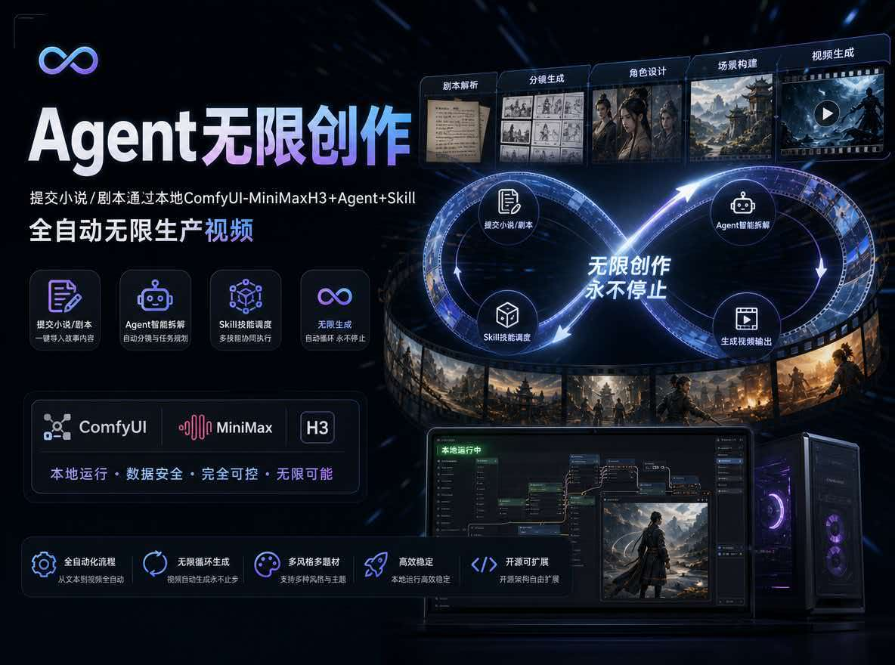

English | [中文](README.md)

## Project Introduction

- An open-source project for fully automated video generation with a free and open-source local agent✨, enabling the creation of ultra-long videos locally with just one click, without requiring actors, voice-overs, directors, or editors. It can be used to generate videos from novels, comic ads, and story-based instructional videos, turning your imagination into billions of frames of visuals.
- One-click generation of videos from novels, with no time limit. Enter the novel/script and use the local ComfyUI-MiniMaxH3+Agent+Skill to automatically generate unlimited videos with one click


## Sample Output

- 《Mom's Time》(妈妈的时间)

<div align="center">
  <video src="https://github.com/user-attachments/assets/3ace95ff-1ec1-46b0-abab-115c76734ee3" width="70%" poster=""> </video>
</div>

[More samples](docs/run_demo.md)

## Roadmap
- [In progress... ] Generating background music and synthesizing it into the video
- [Planned] Docker deployment, desktop app packaging and building
- [Planned] Integrate video super-resolution into the workflow to enhance the clarity of generated videos
- [Planned] Integrate Seedance, Kling, Wan, and the online MiniMax-H3 API for one-click video generation
- [✅] Add Agent security approval policies to prevent Agent from performing unauthorized operations, deleting projects, or executing dangerous commands
- [✅] Integrate the online RunningHub-ComfyUI workflow for generation, with free overnight MiniMax-H3 runs for members
- [✅] Consolidated text-to-image and image-to-image workflows using the latest Qwen-Image 2.1
- [✅] Integrated the Qwen-Image 2.1 text-to-image + image-to-image workflow
- [✅] Support for submitting reference assets, and agent-based organization of reference assets
- [✅] Optimized the local MiniMax H3 character voice (fixed electrical noise / unclear speech issues)
- [✅] Upload novels/scripts to generate videos via a local, fully automated end-to-end Agent workflow
- [✅] Optimized image asset generation quality
- [✅] Optimized sound design for character reference audio
- [✅] Support for character costume management — each character can be designed with multiple outfits

## Mission

Provide an end-to-end integration solution for generating ultra-long videos with Agents.

## Architecture

An **automated "novel/script → video" Agent workflow** built on **local ComfyUI** (MiniMax H3 video GGUF edition + Qwen-Image 2.1 text-to-image/image-to-image + Krea2 text-to-image + Qwen3-TTS). The project currently organizes 27 Skills, including MiniMax-H3 prompt optimization, storyboard script generation, and novel-to-script conversion.

Just paste a novel/script into the project and click "Start" — the Agent fully automates:

> Script/Outline → Character Bible + Style Guide (consistency anchors) → Character/Scene/Prop/Voice asset generation → Storyboard script → Per-shot video (MiniMax H3 Ref2VA) → Self-review & retry → ffmpeg merge into final film.

**No manual intervention required.** It can run unattended for long periods (overnight or all day); when finished, you can review shots segment by segment and regenerate any unsatisfactory clip individually.

## My Machine Specs

```text
OS: Windows 11 (also runs on Linux/Mac)
CPU: 12th Gen Intel(R) Core(TM) i5-12400F
GPU: NVIDIA GeForce RTX 3080 20G
RAM: 32GB DDR4 3200 MT/s (16GBx2)
```

**I haven't yet run detailed tests on how much VRAM specific local GPU configurations need. If you have test results, feel free to share them in the group chat. In theory, 8GB+ VRAM should be sufficient.**

**Note**: ffmpeg must be installed first, otherwise the final video merge may be affected. Download: [https://ffmpeg.org/download.html](https://ffmpeg.org/download.html)

## Core Capabilities

- **Unlimited video length**: Generate videos of any duration without manually adjusting storyboard scripts or video parameters — upload a novel/script and a long video is generated automatically.
- **Automatic shot breakdown**: Automatically splits shots based on character actions, scene changes, and prop movement — no manual intervention.
- **Project isolation**: Each project's asset files + Agent context (character bible / style guide / continuity records) are fully isolated, and resources are organized by category (characters / scenes / props / voices / music / sound effects / other).
- **Character consistency**: One canonical reference image per character reused across shots + unified appearance description + H3 reference-tag rules.
- **Skill system**: Ships with the MiniMax-H3 video Skill + this project's `novel-to-video` main skill; supports extending by dropping a `SKILL.md` into the `skills/` directory.
- **Self-iteration (skill factory)**: Upload a new ComfyUI workflow JSON, automatically parse nodes → generate a workflow spec + draft the corresponding skill — the Agent can call it immediately.
- **Checkpoint/resume**: Task persistence + idempotent skipping; after a process crash/restart it continues without regenerating completed items.
- **Review/regenerate**: Shot-level preview and regeneration (change seed / rewrite prompt based on feedback).
- **Staged execution**: Generation is split into four independent stages — text creation / asset image generation / voice design / storyboard video — any subset can be toggled to run or resume. Batches are split automatically by VRAM constraints, and unneeded stages don't spin up their processes.
- **VRAM maintenance**: The settings page lets you configure "release ComfyUI VRAM every N generations" (default 3, 0 = off), covering text-to-image / image-to-image / costume change / voice / video rendering — AMD Dynamic VRAM's memory accumulation isn't only triggered by video. After a release, the next generation reloads models (about 1–3 minutes extra). When Dynamic VRAM is disabled, the UI shows a prompt recommending it be turned on.
- **Online preview**: Final films / shot videos are streamed via backend Range requests — drag the progress bar freely and jump instantly.

# Screenshots

1. Project Home
   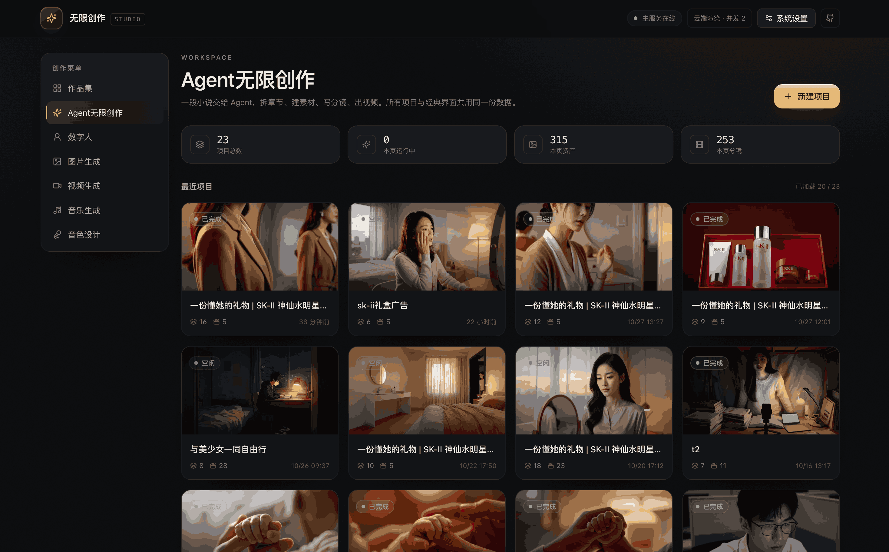
2. Chapter Management
   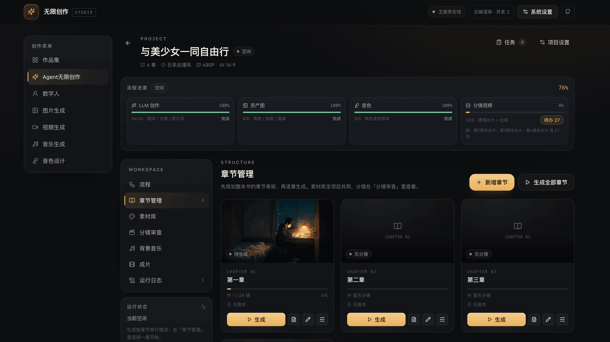
3. Service Configuration
   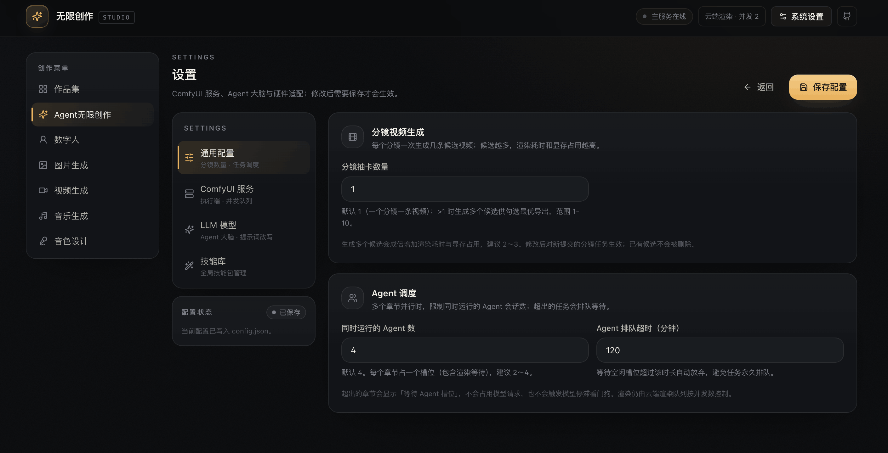
4. Skill Management
   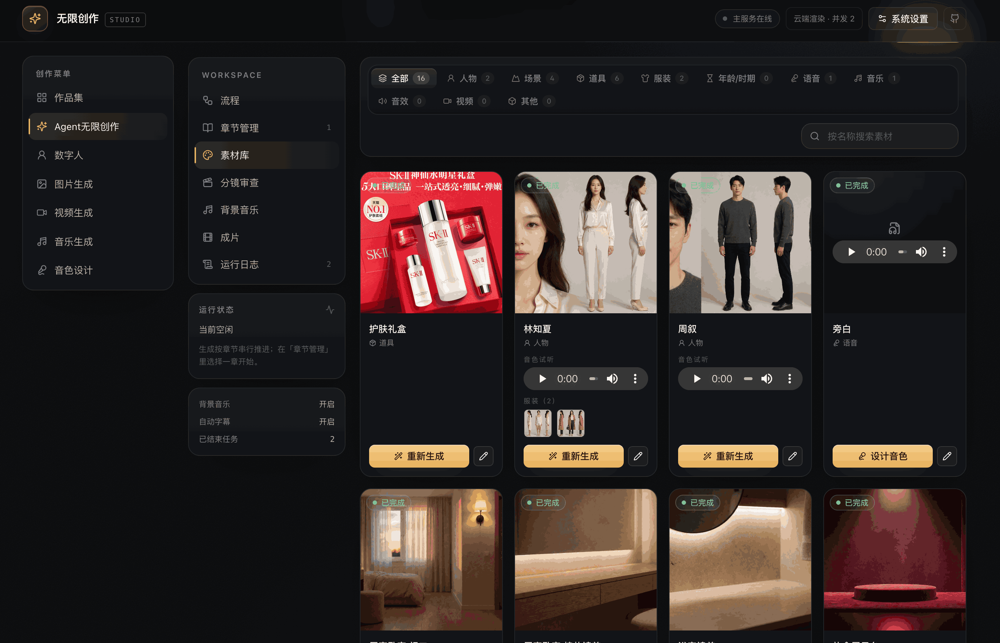
5. Asset Management
   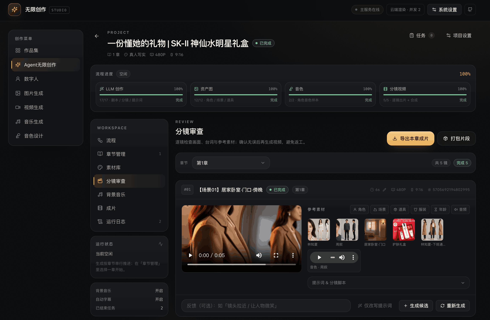
6. Run Logs
   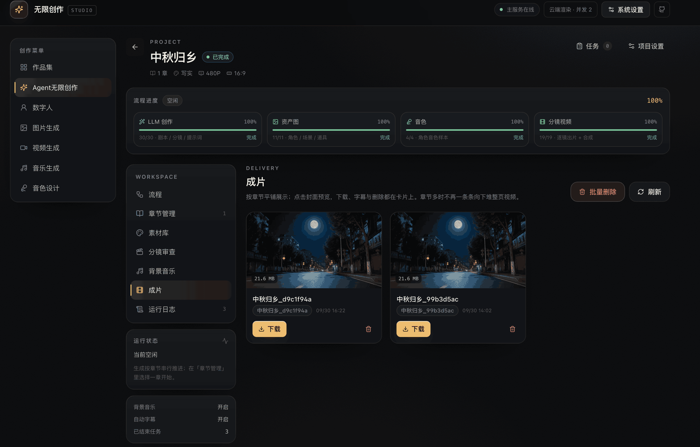
7. Shot Review
   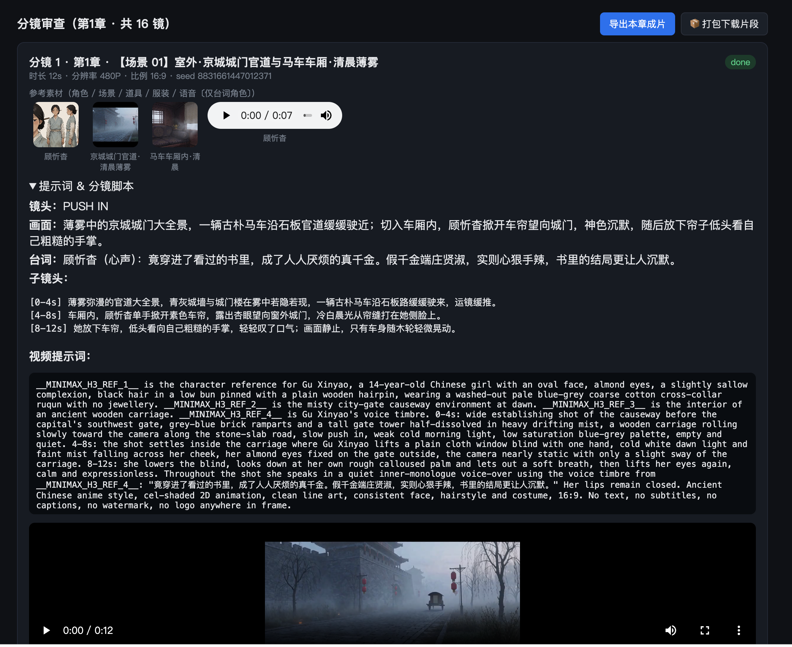
8. Export Final Film
   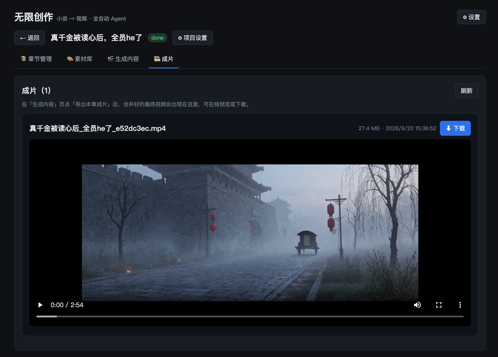

## Tech Stack

- Backend: Node.js (Next.js custom server) + `node:sqlite` + ComfyUI REST/WebSocket + ffmpeg, zero native-compilation dependencies.
- Agent: Self-developed ReAct loop (native function-calling with JSON action-block fallback), tool registry + skill engine + skill factory.
- Frontend: Next.js 15 + React 18 (App Router).
- Structure: single package — `app/` (pages + 30+ API endpoints) · `lib/` (reusable core/agent/shared logic) · `server.js` (custom server: WebSocket progress push + `/files` static hosting with Range-based video streaming).

## Directory Structure

```
infinite-creation/
├── app/                 # Next.js App Router (pages + API endpoints)
├── lib/                 # Reusable logic: core (ComfyUI/LLM/DB/ffmpeg) · agent (runtime + skills) · shared (constants)
├── server.js            # Custom server (WebSocket progress push + /files static hosting, Range streaming)
├── workflows/           # ComfyUI workflow templates (MiniMax H3 video / Qwen-Image 2.1 image & text / Krea2 / Qwen3-TTS, incl. GGUF quantized editions)
├── start-infinite-creation.bat    # Windows one-click background startup (auto-install deps + wait until ready)
├── stop-infinite-creation.bat     # Windows service stop
├── skills/              # Skill library (9 official + novel-to-video + custom)
├── scripts/install-skills.mjs   # Pull MiniMax-H3 official skills
├── tests/unit.test.mjs          # Unit tests
├── vendor/openclaude/           # Agent kernel source (dist/ build artifacts not committed; requires local build)
└── data/                # Runtime (gitignored): SQLite + projects/<id>/…
```

> **About node_modules**: Dependencies are not committed. pnpm generates a single `node_modules` at the project root (real dependencies live under `node_modules/.pnpm/`). **Just run `pnpm install` once at the project root.**

## Quick Start

**Easiest way to start**

- Open Trae, Doubao, CodeX or similar tools; in Doubao use "Work Mode" and enter the prompt:

```text
Help me clone this project https://github.com/SwotAtmk/infinite-creation.git 
locally (fill in the target install directory here), and run it locally.
```

- **国内使用：**
```text
帮我克隆这个项目https://gitcode.com/SwotAtmk/infinite-creation.git到本地（这里填写要安装的项目目录），
并且在本地部署运行这个项目
```

**Prerequisites**

- Node.js ≥ 22 (backend uses built-in `node:sqlite`; Agent kernel requires `>= 22`)
- pnpm ≥ 9 (`npm i -g pnpm`)
- Bun (`pnpm install` uses it to build the Agent kernel once; install at <https://bun.sh>)

**Steps**

```bash
# Clone the project locally
git clone https://github.com/SwotAtmk/infinite-creation.git
cd infinite-creation

# 1. Install all dependencies (run once at root; builds the Agent kernel automatically)
pnpm install

# 2. Pull MiniMax-H3 official skills (optional; repo already contains an offline snapshot)
pnpm run install:skills

# 3. Dev mode: one command to start (single port 4600, frontend + API + WS + static files all hosted)
pnpm run dev
# Open http://127.0.0.1:4600 in your browser

# 4. Production mode: single port 4600, frontend build artifacts hosted by the backend
pnpm run build && pnpm start
# Open http://127.0.0.1:4600 in your browser
```

> Windows users can also double-click `start-infinite-creation.bat` in the root directory for one-click background startup (auto-detects the port / installs dependencies / waits until ready, and reports ComfyUI status). Stop with `stop-infinite-creation.bat`.

> The Agent kernel `vendor/openclaude/dist/` is a build artifact and not committed; `pnpm install` builds it automatically once (idempotent — skips if present). You only need to manually rerun `pnpm build:agent` after modifying `vendor/openclaude/src/` source. See [docs/agent-architecture.md](docs/agent-architecture.md) for build details.

## First-Time Configuration

Click ⚙ in the top-right corner:

1. ComfyUI service URL: default `http://127.0.0.1:8188`, click "Test Connection" to confirm.
2. LLM (the Agent's brain, OpenAI-compatible): fill in Base URL (must end with `/v1`), model, and API Key. Default model is `deepseek-v4-flash-vision-exp`.
3. Generation maintenance (optional): set "release ComfyUI VRAM every N generations" (default on = 3, 0 = off), counted across **all ComfyUI generation tasks** (text-to-image / image-to-image / costume change / voice / video all count — on AMD GPUs with Dynamic VRAM, any consecutive generation gradually slows down). After a release, the next generation reloads models (about 1–3 minutes extra). When ComfyUI is detected as having Dynamic VRAM disabled, the UI shows a prompt recommending it be turned on.

Configuration is saved to `config.json` at the root (not committed). Generation parameters (timeout minutes, concurrency, release frequency) can be edited directly in the `generation` section of `config.json`.

### Required ComfyUI Workflows and Models

Before running this project for the first time, you must install ComfyUI. If you haven't, download and install it from the official ComfyUI site, or use the one-click install package I provide via the cloud-disk link (it includes all models and workflows used). My one-click package currently supports Windows only; Mac users are advised to install manually from the official site, download the models, and run through all the sample workflows.

```txt
I've shared "无限创作-ComfyUI一键安装部署" (Infinite Creation - ComfyUI one-click install) with you on Quark cloud disk. Click the link or copy the whole content and open the "Quark APP" to get it.
/~c2d03b8qfM~:/
Link: https://pan.quark.cn/s/ed2afd0f6a4f?pwd=GVZe
Extraction code: GVZe
```

Before using this Agent project tool, it's recommended to manually run all workflows in ComfyUI first (i.e., run through every workflow in the `comfyui_original_workflows/` directory), after which the Agent project tool can perform fully automated generation.

> Voice: MiniMax H3 synthesizes dialogue itself based on "reference voice samples (flac, etc., placed in assets/voice/) + prompt dialogue"; no separate TTS needed.

### Access cloud computing power - Access RunningHub native ComfyUI interface

- If the local computer configuration is relatively low and cannot run the program, you can choose to use cloud computing power for a free trial

**Claim your free trial of RunningHub's cloud computing power**
```text
Open the link: https://www.runninghub.ai?inviteCode=zjt69ib3
Register now and you can receive 500 RH coins, which can be used to generate plenty of images and videos for free!
```
- Open the browser and navigate to [https://www.runninghub.ai/call-api/bill-task?tab=keys&type=consumer](https://www.runninghub.ai/call-api/bill-task?tab=keys&type=consumer) to obtain the RunningHub Api-Key
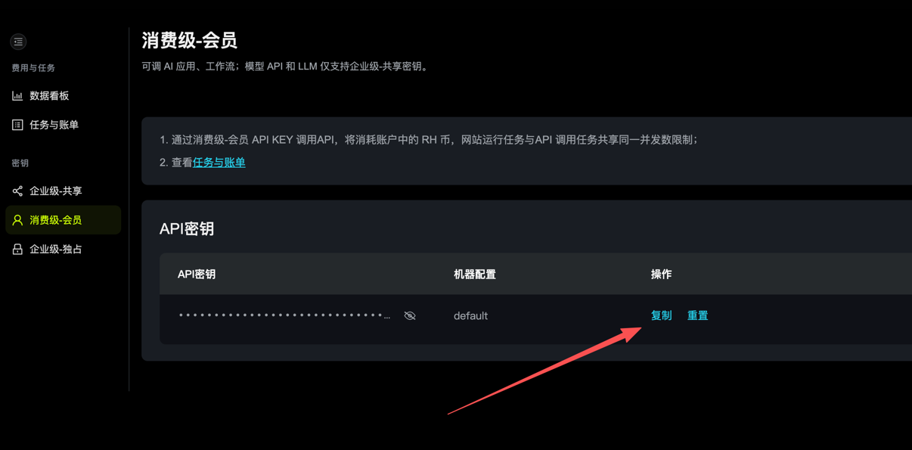

- Configure RunningHub Api-Key
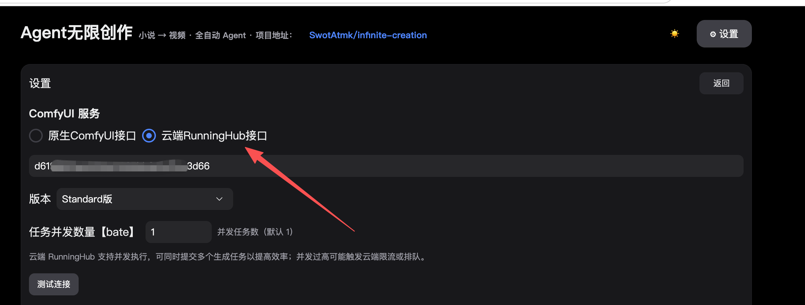

## Usage Flow

1. New project → paste the novel text (or a one-line idea) + style.
2. On the "Generate Content" page, check the stages to run (text creation / asset image generation / voice design / storyboard video; you can check only a subset for resuming), click ▶ Start → watch progress in the console in real time (no intermediate actions needed).
3. After the video stage finishes, the film is merged automatically; go to Shot Review to preview segment by segment, and click ↻ to regenerate any unsatisfactory shot (optional feedback).
4. Go to the "Final Film" page to preview online (draggable progress bar) and ⬇ download.

## Self-Iteration: New Workflow → New Skill

On the Workflows page, paste a new ComfyUI workflow JSON → "Analyze nodes/roles" → "Register workflow + generate skill". The system: parses nodes (loaders / prompts / sizes / seeds / saves…) → derives the workflow spec (roles/media/outputs) → registers it to `workflows/` + DB → calls the LLM to draft a `SKILL.md` and installs it as a routable skill → the Agent can then call it as a new "work mode".

## API Overview

| Method   | Path                                      | Description                          |
| -------- | ----------------------------------------- | ------------------------------------ |
| GET/POST | /api/projects                             | List projects / Create               |
| POST     | /api/projects/:id/run                     | Start fully automated generation     |
| POST     | /api/projects/:id/stop                    | Stop a running task                  |
| GET      | /api/projects/:id/assets?category=        | Assets (by category)                 |
| GET      | /api/projects/:id/shots                   | Shots                                |
| POST     | /api/projects/:id/shots/:sid/regenerate   | Regenerate a single shot             |
| POST     | /api/projects/:id/export                  | Merge & export the final film        |
| GET      | /api/projects/:id/stages                  | Pending counts + stage definitions   |
| POST     | /api/projects/:id/stages                  | Run by stages (check llm/image/tts/video to start a batch, incl. preflight) |
| GET      | /api/skills                               | Skill list                           |
| GET/POST | /api/workflows                            | Workflow list / register (self-iteration) |
| GET/PUT  | /api/config                               | Configuration                        |
| WS       | /ws                                       | Task progress push                   |

## Tests

pnpm test   # node --test tests/unit.test.mjs

## Notes & Limitations

- Videos are generated shot-by-shot serially (ComfyUI has limited single-GPU concurrency); a single shot takes minutes-level; total film time depends on the number of shots and duration.
- H3 reference limits: images ≤9, audio/video ≤3 (exceeding them errors out automatically).
- Final films are uniformly transcoded to H.264 + AAC (24fps) to ensure playability.
- Tasks are background-persistent; you can resume after refreshing the page / restarting the service (idempotent skip of completed items).
- Default single-video timeout is 90 minutes (normal single shots are far below this — fallback only); adjustable via `generation.videoTimeoutMinutes` in `config.json`.
- Every N generation tasks, ComfyUI `/free` is called once to release VRAM (`generation.freeAfterEvery`, default 3, 0 = off; also compatible with the old key `videoFreeAfterEvery`), covering all rendering and countering the speed degradation of AMD Dynamic VRAM after consecutive generations; cleanup takes effect after the next task completes, and failure doesn't affect output.
- LLM runtime watchdog: when model output is truncated (`[Response truncated …]`) or the upstream stalls, tasks no longer hang indefinitely — 3 consecutive pure-truncation no-progress events, or 20 minutes without a message (tool-rendering window excluded), auto-abort and mark as failed; slow local models can loosen the no-message threshold via `generation.agentStallMinutes` (default 20).

# Check Out My Tool Site

I've collected many useful little tools there — interested in learning more?

- Get the latest project news and practical tools
- [淘项Hub: https://tx3247.t.taoxiangyoushu.com/?f=0zv5vo2](https://tx3247.t.taoxiangyoushu.com/?f=0zv5vo2)

# Join the Group Chat to Report Issues or Suggest Improvements


## Reference Projects & Special Thanks

- [nextjs](https://nextjs.org/) — the Next.js framework for building web apps
- [MiniMax-H3 official repo: https://github.com/MiniMax-AI/MiniMax-H3](https://github.com/MiniMax-AI/MiniMax-H3) — the H3 model and Skills
- [OpenClaude: https://github.com/Gitlawb/openclaude](https://github.com/Gitlawb/openclaude) — the Agent kernel and workflow management
- [Comfy-Org/ComfyUI](https://github.com/Comfy-Org/ComfyUI) — the ComfyUI workflows and model architecture
- [deepseek](https://www.deepseek.com/) — thanks to DeepSeek for the deepseek-v4-flash-vision-exp model

Thank you to these projects for enabling rapid iteration and improvement.

## Author's Note

This project was independently completed by an individual developer. Feedback, bug reports, and promotion are all welcome — let's build a better product for more people to discover. The project has just been open-sourced, so there may be many areas that need adjustment and optimization. Issues and further optimizations are welcome. Thank you to everyone who contributes to this project.

## Acknowledgements

- Thanks to developer [happymy](https://github.com/happymy) for providing the AMD + GGUF adaptation solution and fixing some bugs in the project.
- Thank you to the developer [binonxia]（ https://github.com/binonxia ）Discovered and fixed bugs in the project


## Star History

<a href="https://www.star-history.com/?repos=swotatmk%2Finfinite-creation&type=date&legend=bottom-right">
 <picture>
   <source media="(prefers-color-scheme: dark)" srcset="https://api.star-history.com/chart?repos=swotatmk/infinite-creation&type=date&theme=dark&legend=bottom-right" />
   <source media="(prefers-color-scheme: light)" srcset="https://api.star-history.com/chart?repos=swotatmk/infinite-creation&type=date&legend=bottom-right" />
   
 </picture>
</a>

## License

This project is open-sourced under the [MIT License](LICENSE). MIT is the most permissive open-source license — you may use it commercially and create derivative works, but must retain the original statement.

Copyright (c) 2026 SwotAtmk

> Note: Some skills in the `skills/` directory originate from the MiniMax-H3 official repository, and the `vendor/` directory contains third-party code. These are not covered by this project's MIT license — please follow their respective licensing terms.
