<div align="center">

# Agent Infinite Creation · Turn Your Stories into a Billion Frames

**Free, open-source, fully automated local-agent video generation ✨**
Upload a novel or script and generate films of any length locally — unattended.

<a href="https://github.com/SwotAtmk/infinite-creation/stargazers"></a> <a href="README.md"></a> <a href="https://github.com/SwotAtmk/infinite-creation/blob/main/LICENSE"></a> <a href="https://nodejs.org/"></a>

</div>

<p align="center">
  <a href="#quick-start"><strong>Quick Start</strong></a>
  ·
  <a href="docs/technical_EN.md">Technical Docs</a>
  ·
  <a href="#hardware">Hardware</a>
  ·
  <a href="#community">Join the Community</a>
</p>

<p align="center">
  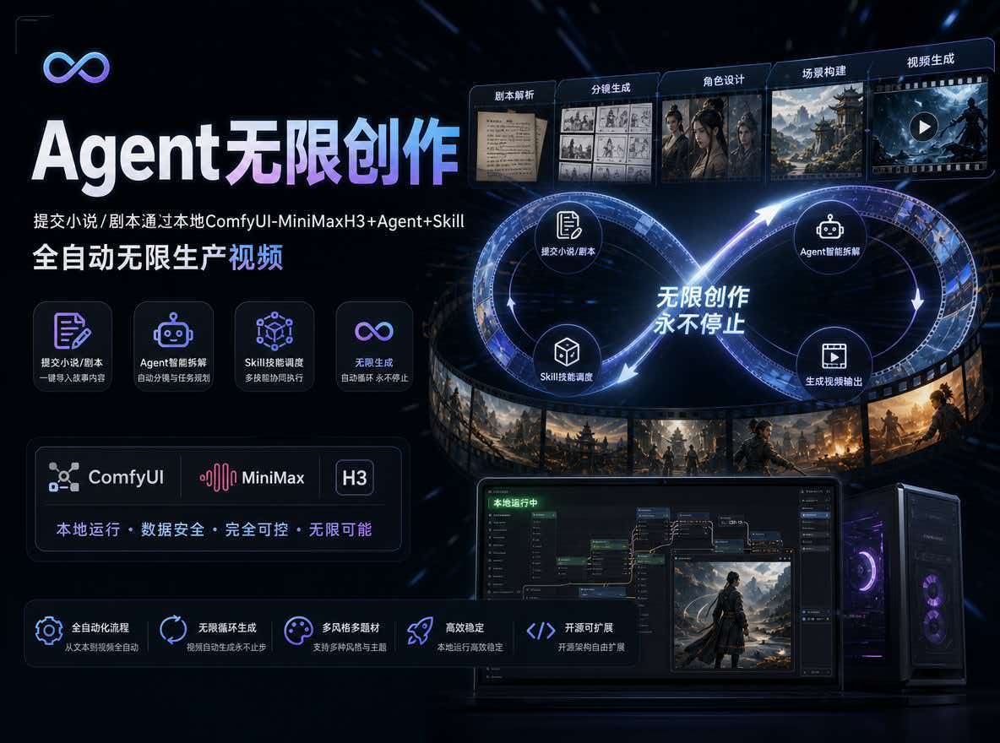
</p>

## Sponsors

<table>
  <tr>
    <td width="200" align="center" valign="top">
      <a href="https://admins.taoxiangyoushu.com/#/register?code=FzH3DEp">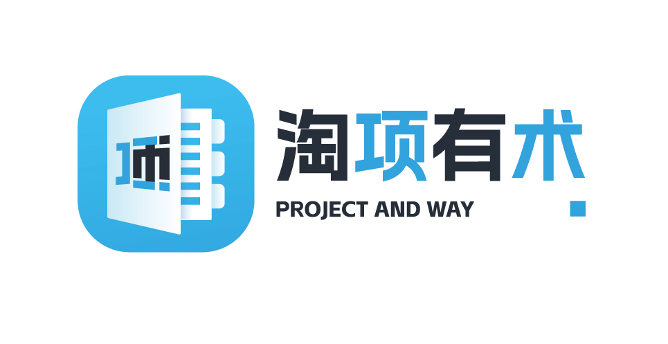</a>
    </td>
    <td valign="top">
      <strong>Taoxiang Youshu: an all-in-one AI application service platform</strong><br>
      Brings together trending AI projects, a side-hustle and light-entrepreneurship community, and a business knowledge base — helping individuals pick up AI projects at low cost and find practical side businesses. <a href="https://admins.taoxiangyoushu.com/#/register?code=FzH3DEp">Sign up via the referral link</a> You can then receive a redemption code for a [7-day SVIP membership]:: TsHcxt0t
    </td>
  </tr>
</table>

If you or your team find it valuable, sponsoring is the most direct way to keep it moving forward:

- Your brand / product featured at the top of this README, seen by every visitor
- Room for a short product description plus a website / sign-up link
- Sponsorship amount, duration and benefits are open to discussion

**Contact**: [swotatmk@foxmail.com](mailto:swotatmk@foxmail.com) (please put "Sponsorship" in the subject)

## UI Overview

<table>
  <tr>
    <td width="50%">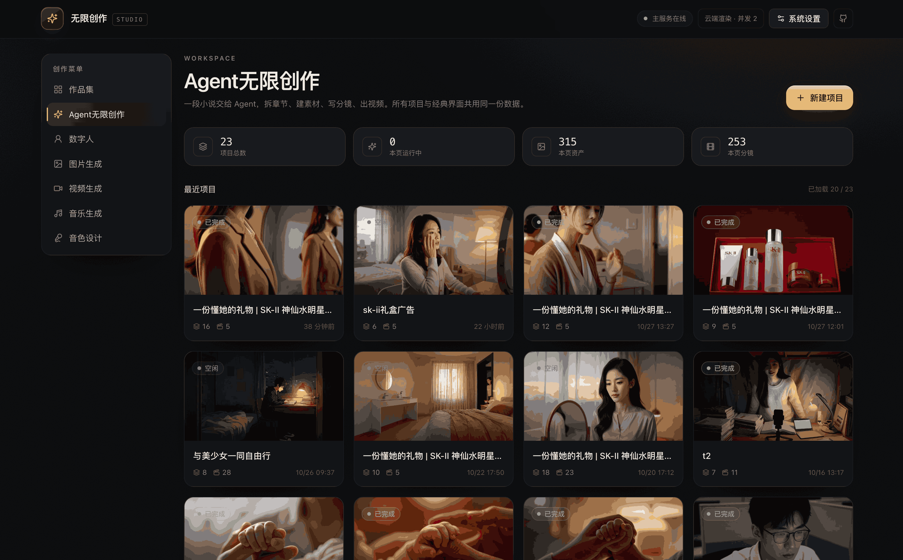</td>
    <td width="50%">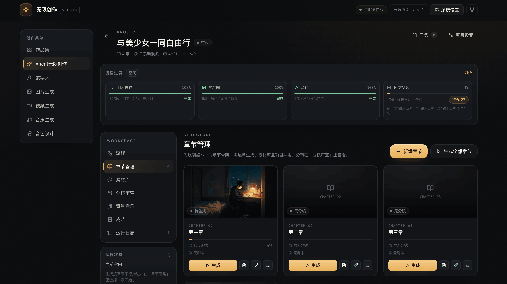</td>
  </tr>
  <tr>
    <td width="50%">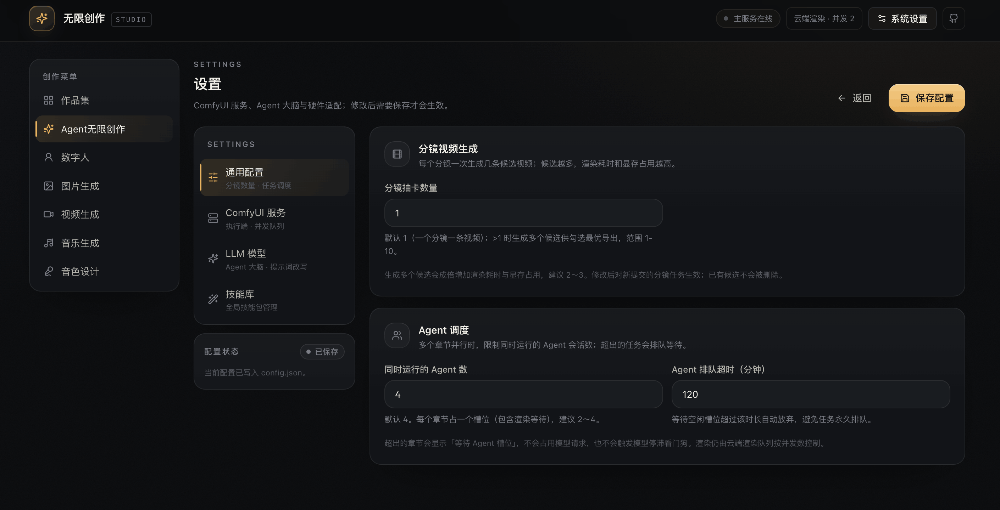</td>
    <td width="50%">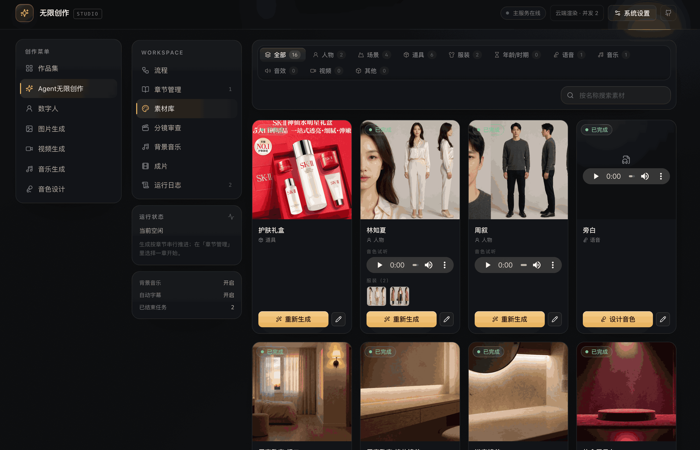</td>
  </tr>
  <tr>
    <td width="50%">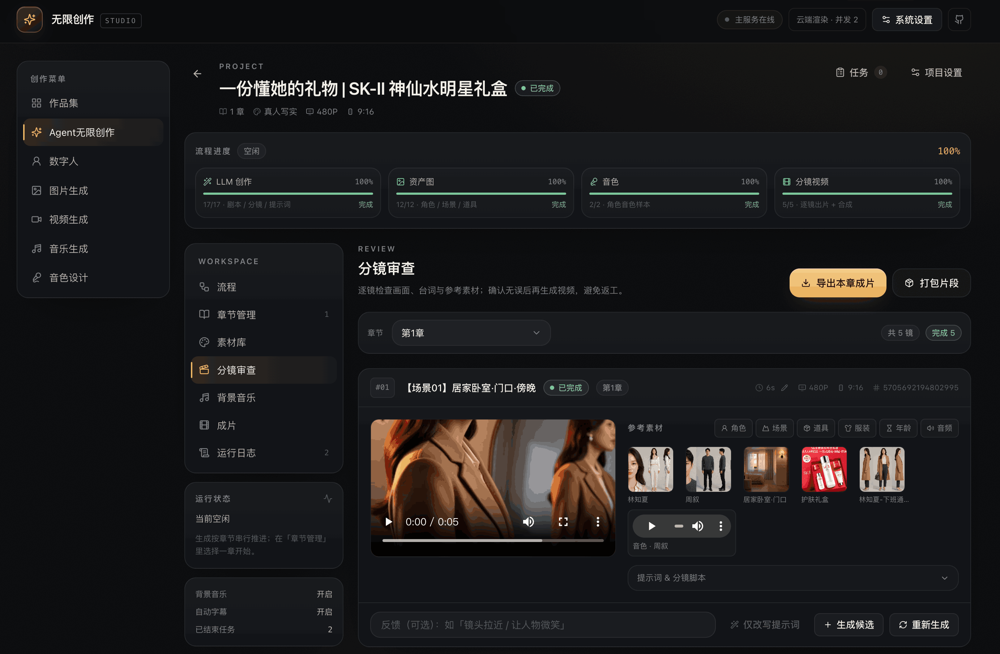</td>
    <td width="50%">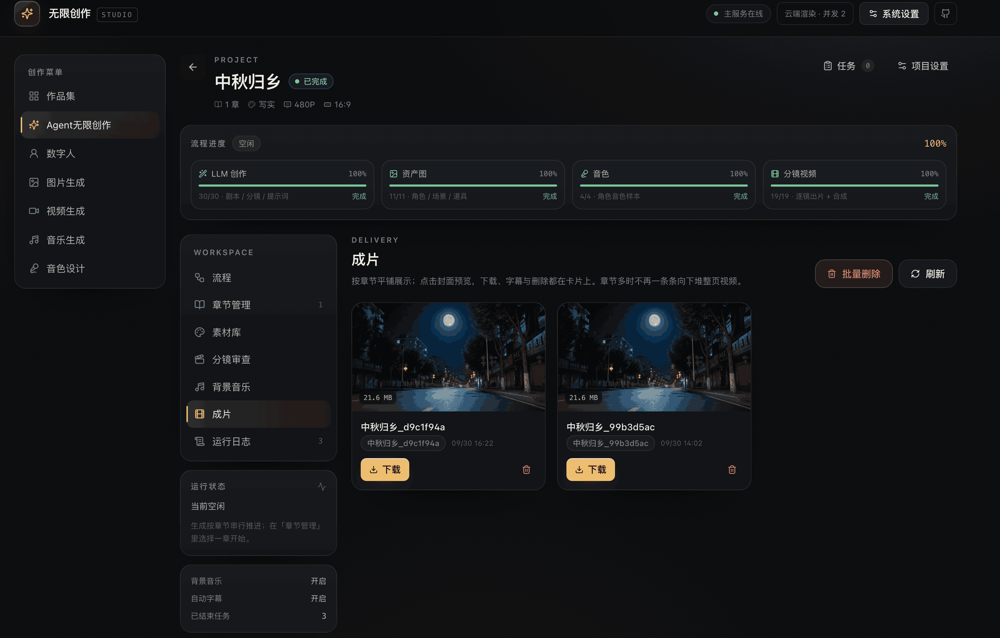</td>
  </tr>
</table>

## Samples

<div align="center">
  <video src="https://github.com/user-attachments/assets/3ace95ff-1ec1-46b0-abab-115c76734ee3" width="70%" controls></video>
</div>

> 《Mom's Time》(妈妈的时间)

<div align="center">
  <video src="https://github.com/user-attachments/assets/c415e1bb-ce1a-46fe-b97f-00362899eed3" width="70%" controls></video>
</div>

> Created by experience officer 「闪电.」 with infinite-creation

[More samples](docs/run_demo.md) · Rank Shadow ships built-in samples under `public/samples/`: click "Preview samples" in the top-right corner to play the film, inspect its materials and prompt, and try it with one click.

## What is Agent Infinite Creation

An open-source, local workbench for novel adaptations, comic-drama ads, and story-driven explainer videos. It organizes content analysis, asset management, storyboarding, media generation, cost tracking, and export into one reviewable, resumable production pipeline — no actors, voice actors, directors, or editors required.

- **Two creation workspaces**: **Agent Infinite Creation** (novel / script → long video) and **Rank Shadow** (powered by the lemo-opuscar code-film skill: 66 style templates + any materials + a prompt, with the Agent rendering a styled film locally — no ComfyUI required).
- **One production chain**: once a novel or script enters a project, the Agent produces the character bible, style guide, character / scene / prop / voice assets, storyboard script, per-shot videos, background music, subtitles, and the final ffmpeg merge.
- **Consistent and controllable**: canonical reference images and scene blocking tables are reused across shots; key stages can be reviewed, single shots can be regenerated, and the change log supports rollback.
- **Runs locally or in the cloud**: local ComfyUI (12GB+ VRAM) or RunningHub cloud compute; you can also hand the pipeline to a local CLI Agent through the MCP tool bridge.
- **Deliverables stay editable**: automatic subtitles can be toggled (a subtitle-free copy and SRT are kept), the background-music library supports generate / preview / apply to multiple chapters, and exports can be deleted individually or in batch.

## Core Capabilities

- **Unlimited video length**: Generate videos of any duration without manually adjusting storyboard scripts or video parameters — upload a novel/script and a long video is generated automatically.
- **Automatic shot breakdown**: Automatically splits shots based on character actions, scene changes, and prop movement — no manual intervention.
- **Project isolation**: Each project's asset files + Agent context (character bible / style guide / continuity records) are fully isolated, and resources are organized by category (characters / scenes / props / voices / music / sound effects / other).
- **Character consistency**: One canonical reference image per character reused across shots + unified appearance description + H3 reference-tag rules.
- **Skill system**: Ships with the MiniMax-H3 video Skill + this project's `novel-to-video` main skill; supports extending by dropping a `SKILL.md` into the `skills/` directory.
- **Self-iteration (skill factory)**: Upload a new ComfyUI workflow JSON, automatically parse nodes → generate a workflow spec + draft the corresponding skill — the Agent can call it immediately.
- **Checkpoint/resume**: Task persistence + idempotent skipping; after a process crash/restart it continues without regenerating completed items.
- **Review/regenerate**: Shot-level preview and regeneration (change seed / rewrite prompt based on feedback).
- **Background music**: The video stage automatically generates instrumental background music and synthesizes it into the final film; a dedicated "Background Music" library supports manual generation (with caption / lyrics / duration), preview, selection, and applying a track to multiple completed chapters at once.
- **Automatic subtitles**: A project-level "auto subtitles" toggle burns shot dialogue/narration into the final video on a shot-based timeline (speaker names stripped), while also keeping a subtitle-free copy and an SRT file. The "Exports" page lets you download the subtitled video, the subtitle-free video, or the SRT, and supports single or batch deletion.
- **Staged execution**: Generation is split into four independent stages — text creation / asset image generation / voice design / storyboard video — any subset can be toggled to run or resume. Batches are split automatically by VRAM constraints, and unneeded stages don't spin up their processes.
- **VRAM maintenance**: The settings page lets you configure "release ComfyUI VRAM every N generations" (default 3, 0 = off), covering text-to-image / image-to-image / costume change / voice / video rendering — AMD Dynamic VRAM's memory accumulation isn't only triggered by video. When Dynamic VRAM is disabled, the UI shows a prompt recommending it be turned on.
- **Online preview**: Final films / shot videos are streamed via backend Range requests — drag the progress bar freely and jump instantly.
- **External Agent runtime**: Besides the built-in openclaude, switch on the settings page to a locally installed CLI agent (Claude Code / Codex CLI / Gemini CLI / Qwen Code / Cursor Agent / Qoder CLI / Grok Build / Hermes / custom command), exposing domain tools to it via a local MCP stdio service so it fully takes over the pipeline; model accounts and sign-in state stay with each CLI.
- **Rank Shadow (code film)**: Integrates the lemo-opuscar skill with 66 style templates (category filtering + custom style). Upload any images / audio / video / documents plus a prompt, and the Agent writes the render code locally and muxes the result with ffmpeg. Built-in samples support preview and one-click trial; generation records support query, edit, regenerate, stop and batch delete, and never occupy the ComfyUI render queue.

## From Input to Film

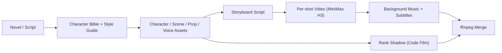

Every stage can be automated by the Agent or reviewed, adjusted and regenerated in the workbench. See the [Technical Documentation](docs/technical_EN.md) for details.

## Quick Start

**Up and running in one command**

```bash
git clone https://github.com/SwotAtmk/infinite-creation.git
cd infinite-creation
pnpm install              # installs dependencies (builds the Agent kernel automatically)
pnpm run install:skills   # optional: pull MiniMax-H3 official skills
pnpm run dev              # starts Studio by default; open http://127.0.0.1:4710
```

> Prerequisites: Node.js ≥ 22, pnpm ≥ 9, Bun, ffmpeg. Production mode, running Studio and the classic UI separately, Windows one-click scripts, database and ComfyUI setup are all covered in the [Technical Documentation](docs/technical_EN.md).

**Easiest way to start**

- Open Trae, Doubao, CodeX or similar tools; in Doubao use "Work Mode" and enter the prompt:

```text
Help me clone this project https://github.com/SwotAtmk/infinite-creation.git 
locally (fill in the target install directory here), and run it locally.
```

- **For users in China:**
```text
Help me clone this project https://gitcode.com/SwotAtmk/infinite-creation.git 
locally (fill in the target install directory here), and run it locally.
```

- **Agent auto startup**

```text
Please refer to https://gitcode.com/SwotAtmk/infinite-creation/releases/download/v1.0.0/install-skill.md for installation instructions,
Install the infinite-creation skill from GitHub (overseas) or GitCode (domestic), then start the project according to the skill description.
```

## Hardware

My machine:

```text
OS: Windows 11 (also runs on Linux/Mac)
CPU: 12th Gen Intel(R) Core(TM) i5-12400F
GPU: NVIDIA GeForce RTX 3080 20G
RAM: 32GB DDR4 3200 MT/s (16GBx2)
```

Minimum requirements for local operation:

```text
Graphics card: The minimum requirement for the graphics card is 12GB of VRAM [those with development capabilities can adapt to a version that can run with 8GB]
CPU: No specific processor required
Memory: Recommended 32GB or above
Hard disk: At least 150G of space is required
```

**I haven't conducted detailed tests on the specific local graphics card configuration and required video memory size. If your computer can run this project normally, please join the group chat to share your minimum viable configuration**

**Note**: ffmpeg must be installed first, otherwise the final video merge may be affected. Download: [https://ffmpeg.org/download.html](https://ffmpeg.org/download.html)

## ComfyUI Setup

### Required Workflows and Models

Before running the project for the first time, it is necessary to install the ComfyUI tool. If it is not installed, you can download and install it from the Comfyui official website, or use the one click installation package provided by me (the one click installation package contains all the models and workflows used in the workflow). Currently, the one click installation package only supports Windows systems. It is recommended to manually install it from the official website for Mac systems, download the model, and run all the example workflows.

**Third-party service disclaimer: The ComfyUI one-click integration package was developed by a third-party expert, and may involve some fee-related issues related to third-party websites. Its creation is not easy, so please support it rationally. Please check carefully to avoid being deceived, and do not trust any stranger who adds you on social media to sell you information.**
```txt
I've shared "无限创作-ComfyUI一键安装部署" (Infinite Creation - ComfyUI one-click install) with you on Quark cloud disk. Click the link or copy the whole content and open the "Quark APP" to get it.
/~c2d03b8qfM~:/
Link: https://pan.quark.cn/s/ed2afd0f6a4f?pwd=GVZe
Extraction code: GVZe
```
It is recommended that those who have ComfyUI related technology can install and complete the relevant plugins and models themselves, and run the relevant workflows in the comfyui_original_workflows folder. Note: distinguish the workflows of NVIDIA graphics cards and AMD graphics cards

Before using this Agent project tool, it's recommended to manually run all workflows in ComfyUI first (i.e., run through every workflow in the `comfyui_original_workflows/` directory), after which the Agent project tool can perform fully automated generation.

> Voice: MiniMax H3 synthesizes dialogue itself based on "reference voice samples (flac, etc., placed in assets/voice/) + prompt dialogue"; no separate TTS needed.

### Cloud Compute - RunningHub Native ComfyUI API

- If the local computer configuration is relatively low and cannot run the program, you can choose to use cloud computing power for a free trial

**Claim your free trial of RunningHub's cloud computing power**
```text
Open the link: https://www.runninghub.cn?inviteCode=6to0etcb
Register now and you can receive 500 RH coins, which can be used to generate plenty of images and videos for free!
```
- Open the browser and navigate to [https://www.runninghub.cn/call-api/bill-task?tab=keys&type=consumer&inviteCode=6to0etcb](https://www.runninghub.cn/call-api/bill-task?tab=keys&type=consumer&inviteCode=6to0etcb) to obtain the RunningHub Api-Key
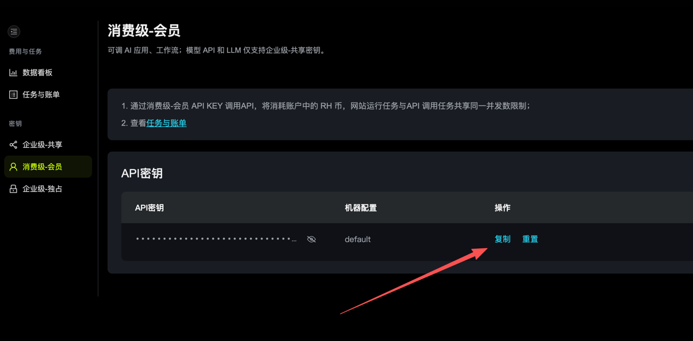

- Configure RunningHub Api-Key
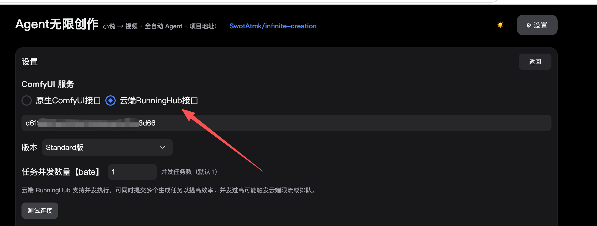

- My RunningHub workflow homepage: [https://www.runninghub.cn/user-center/2013421139631808514/webapp?inviteCode=6to0etcb](https://www.runninghub.cn/user-center/2013421139631808514/webapp?inviteCode=6to0etcb)

## Documentation

| Page | Contents |
|---|---|
| [Technical Documentation](docs/technical_EN.md) | Tech stack, directory structure, setup and startup, first-time configuration, usage flow, API overview, tests and limitations |
| [Agent architecture](docs/agent-architecture.md) | Agent kernel, external CLI runtime and the MCP tool bridge |
| [Writer API design](docs/writer-api-plan.md) | Design trade-offs and round-by-round log for letting AI coding tools write content |
| [Sample outputs](docs/run_demo.md) | Generation results and built-in samples |
| [SKILL.md](SKILL.md) | The full contract for the agent |
| [中文 README](README.md) | Chinese documentation |

## Roadmap

- [Ongoing] Addressing BUGs in the project
- [Planned] Adaptation for home-grade GPUs with low VRAM — the blogger's testing equipment is limited. More users are needed to help with testing and provide feedback to the repository's Issues. Please contribute your insights! 🙏
- [Planned] Address and optimize issues such as tool invocation security and context compression in internal agents
- [Planned] Plugin system development, supporting plugin upload, plugin invocation, plugin framework
- [Planned] Automated Pipeline Supports Custom Prompt Assembly Plugins
- [Planned] Incorporate more advanced Skills to enhance the visual aesthetic of Agent skills
- [Planned] For the beautification work of the tool Web page, a highly aesthetic AI designer is needed
- [Planned] Package and build Docker deployment, desktop app
- [Planned] Integrate video super-resolution into the workflow to enhance the clarity of generated videos
- [Planned] Integrate Seedance, Kling, Wan, and the online MiniMax-H3 API for one-click video generation
- [✅] Support the generation of multiple videos from a single storyboard configuration, based on a model that selects the best cards from the storyboard
- [✅] Internet search skill support, e.g. asset generation can search for reference images (such as specific Huawei phone or Apple MacBook models) and use them as references to generate new assets
- [✅] Agent automatically selects text-to-video, image-to-video, first/last-frame, or digital-human mode based on the actual use case (digital-human mode is currently reservation-only, not yet wired end-to-end)
- [✅] Support uploading txt text files, automatically parsing and creating multiple chapters and sharing reference assets
- [✅] New "Scene Blocking Consistency" Skill: builds a character/prop staging map per scene (spatial anchors + character positions + 180-degree axis) to eliminate left-right drift and axis-crossing issues across shots
- [✅] External Agent runtime: support local CLI agents (Claude Code, Codex CLI, Gemini CLI, Qwen Code, Cursor Agent, Qoder CLI, Grok Build, Hermes, custom command) to take over the "novel→video" pipeline via a local MCP tool bridge, while keeping the built-in openclaude as the default runtime
- [✅] Automatic video subtitles: a project-level toggle burns shot dialogue/narration into the final video on a shot-based timeline (speaker names stripped), with a subtitle-free copy and a downloadable SRT file
- [✅] Support background music management: integrate MiniMax Music3 for local/cloud automatic background-music generation and synthesis into videos, with a "Background Music" library (manual generation / preview / select / apply to chapters)
- [✅] Add Agent security approval policies to prevent Agent from performing unauthorized operations, deleting projects, or executing dangerous commands
- [✅] Integrate the online RunningHub-ComfyUI workflow for generation, with free overnight MiniMax-H3 runs for members
- [✅] Package the project as a Skill for one-click Agent invocation
- [✅] Consolidated text-to-image and image-to-image workflows using the latest Qwen-Image 2.1
- [✅] Integrated the Qwen-Image 2.1 text-to-image + image-to-image workflow
- [✅] Support for submitting reference assets, and agent-based organization of reference assets
- [✅] Optimized the local MiniMax H3 character voice (fixed electrical noise / unclear speech issues)
- [✅] Upload novels/scripts to generate videos via a local, fully automated end-to-end Agent workflow
- [✅] Optimized image asset generation quality
- [✅] Optimized sound design for character reference audio
- [✅] New "Rank Shadow" code-film mode: integrates lemo-opuscar's 66 style templates, with preset/custom styles, upload of any materials, sample preview and one-click trial, plus generation records (query / edit / regenerate / stop / delete / batch delete)
- [✅] Support for character costume management — each character can be designed with multiple outfits

## Community

Scan the QR code to join the group chat and share feedback or suggestions:


For reproducible bugs or clear feature requests, feel free to open a [GitHub Issue](https://github.com/SwotAtmk/infinite-creation/issues).

## Contributing

Code, docs, skills and bug reproductions are all welcome. Development, testing and API contracts are covered in the [Technical Documentation](docs/technical_EN.md).

## Reference Projects & Special Thanks

- [nextjs](https://nextjs.org/) — the Next.js framework for building web apps
- [MiniMax-H3 official repo: https://github.com/MiniMax-AI/MiniMax-H3](https://github.com/MiniMax-AI/MiniMax-H3) — the H3 model and Skills
- [OpenClaude: https://github.com/Gitlawb/openclaude](https://github.com/Gitlawb/openclaude) — the Agent kernel and workflow management
- [Comfy-Org/ComfyUI](https://github.com/Comfy-Org/ComfyUI) — the ComfyUI workflows and model architecture
- [deepseek](https://www.deepseek.com/) — thanks to DeepSeek for the deepseek-v4-flash-vision-exp model
- Reference Open-Source Skills: [short-drama](https://github.com/0xsline/short-drama)、[manju-laoli-skill](https://github.com/lixiaoxiao9888-create/manju-laoli-skill)
- [lemomo-ai/lemo-opuscar](https://github.com/lemomo-ai/lemo-opuscar) — Provided a core framework for Infinite·Rank Shadow

Thank you to these projects for enabling rapid iteration and improvement.

## Author's Note

Welcome everyone to provide feedback, find and report bugs, and help spread the word. Let's create a better product for more people to discover. The project has just been open-sourced, and there may be many areas that need adjustment and optimization. We welcome everyone to submit issues or make further optimizations based on my work. Thank you to everyone who contributes to this project.

## Acknowledgements

- Thank you to the developer [taoxiangyoushu](https://github.com/taoxiangyoushu) for their contribution to this project. They have integrated the workflow mode of Tusense video + first and last frames and fixed some bugs
- Thanks to developer [happymy](https://github.com/happymy) for providing the AMD + GGUF adaptation solution and fixing some bugs in the project.
- We would like to express our gratitude to the following developers for their contributions to the project: [thrasher824](https://github.com/thrasher824)、[remiliakui](https://github.com/remiliakui)、[ghshhf](https://github.com/ghshhf), [binonxia](https://github.com/binonxia), [anupamme](https://github.com/anupamme)

## Star History

<a href="https://www.star-history.com/?repos=swotatmk%2Finfinite-creation&type=date&legend=bottom-right">
 <picture>
   <source media="(prefers-color-scheme: dark)" srcset="https://api.star-history.com/chart?repos=swotatmk/infinite-creation&type=date&theme=dark&legend=bottom-right" />
   <source media="(prefers-color-scheme: light)" srcset="https://api.star-history.com/chart?repos=swotatmk/infinite-creation&type=date&theme=light&legend=bottom-right" />
   
 </picture>
</a>

## License

This project is open-sourced under the [MIT License](LICENSE). MIT is the most permissive open-source license — you may use it commercially and create derivative works, but must retain the original statement.

Copyright (c) 2026 SwotAtmk

> Note: Some skills in the `skills/` directory originate from the MiniMax-H3 official repository, and the `vendor/` directory contains third-party code. These are not covered by this project's MIT license — please follow their respective licensing terms.
