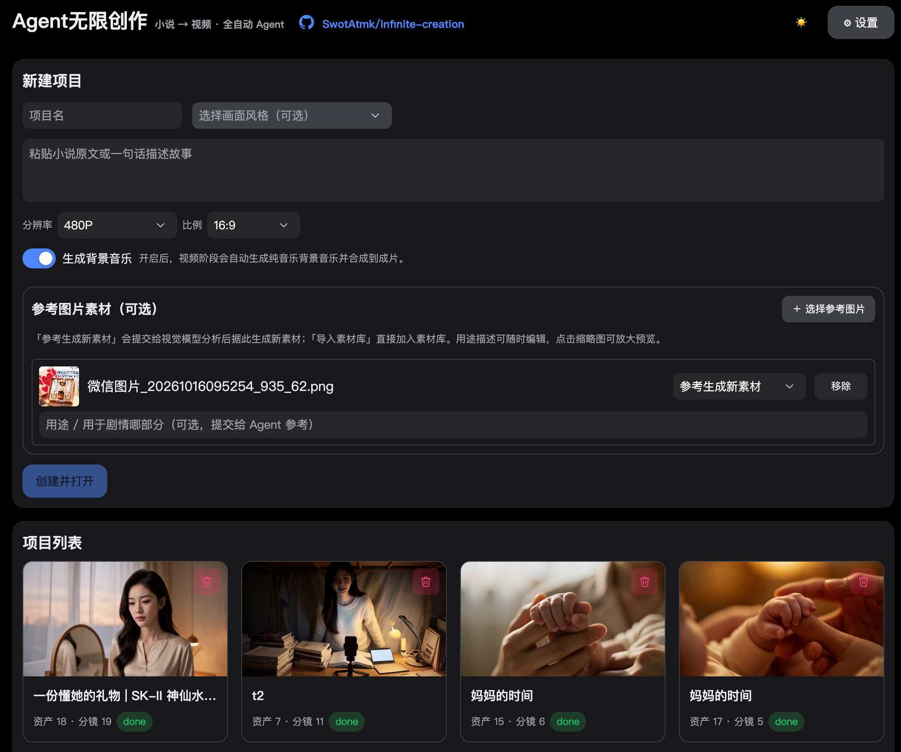
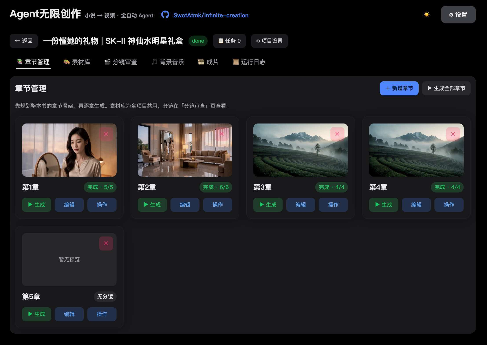
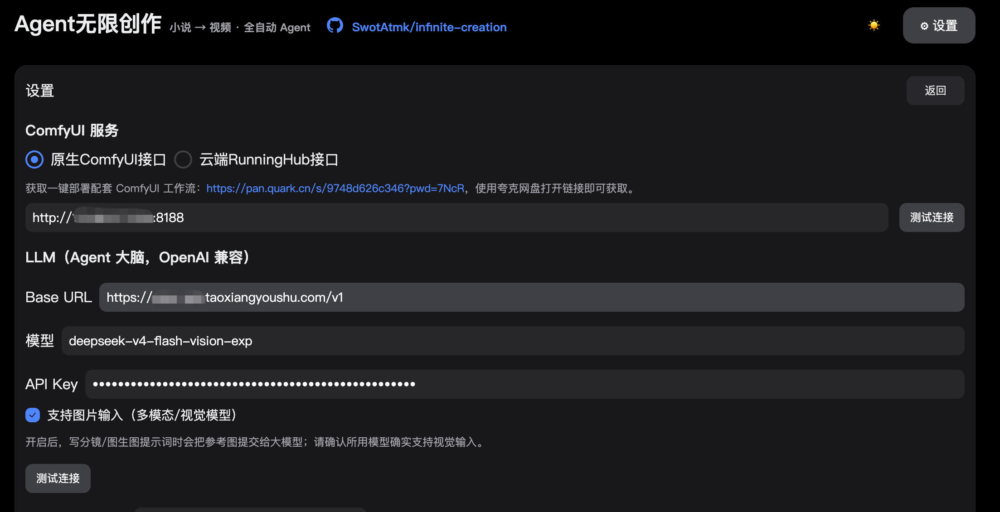

<div align="center">

# Agent Infinite Creation · Turn Your Stories into a Billion Frames

**Free, open-source, fully automated local-agent video generation ✨ — turn novels/scripts into long videos with one click.**<br>
<sub>🇨🇳 中文用户请看 <a href="README.md">简体中文说明</a></sub>

<a href="https://github.com/SwotAtmk/infinite-creation/stargazers"></a> <a href="README.md"></a> <a href="https://github.com/SwotAtmk/infinite-creation/blob/main/LICENSE"></a> <a href="https://nodejs.org/"></a>

</div>


## Project Introduction

- An open-source project for fully automated video generation with a free and open-source local agent✨, enabling the creation of ultra-long videos locally with just one click, without requiring actors, voice-overs, directors, or editors. It can be used to generate videos from novels, comic ads, and story-based instructional videos, turning your imagination into billions of frames of visuals.
- One-click generation of videos from novels, with no time limit. Enter the novel/script and use the local ComfyUI-MiniMaxH3+Agent+Skill to automatically generate unlimited videos with one click


## Sample Output

- 《Mom's Time》(妈妈的时间)

<div align="center">
  <video src="https://github.com/user-attachments/assets/3ace95ff-1ec1-46b0-abab-115c76734ee3" width="70%" poster=""> </video>
</div>

[More samples](docs/run_demo.md)

## Roadmap
- [Ongoing] Addressing BUGs in the project
- [Planned] Internet search skill support, e.g. asset generation can search for reference images (such as specific Huawei phone or Apple MacBook models) and use them as references to generate new assets
- [✅] Agent automatically selects text-to-video, image-to-video, first/last-frame, or digital-human mode based on the actual use case (digital-human mode is currently reservation-only, not yet wired end-to-end)
- [Planned] Adaptation for home-grade GPUs with low VRAM — the blogger's testing equipment is limited. More users are needed to help with testing and provide feedback to the repository's Issues. Please contribute your insights! 🙏
- [Planned] Address and optimize issues such as tool invocation security and context compression in internal agents
- [Planned] Plugin system development, supporting plugin upload, plugin invocation, plugin framework
- [Planned] Automated Pipeline Supports Custom Prompt Assembly Plugins
- [Planned] Incorporate more advanced Skills to enhance the visual aesthetic of Agent skills
- [Planned] For the beautification work of the tool Web page, a highly aesthetic AI designer is needed
- [Planned] Package and build Docker deployment, desktop app
- [Planned] Integrate video super-resolution into the workflow to enhance the clarity of generated videos
- [Planned] Integrate Seedance, Kling, Wan, and the online MiniMax-H3 API for one-click video generation
- [✅] Support uploading txt text files, automatically parsing and creating multiple chapters and sharing reference assets
- [✅] New "Scene Blocking Consistency" Skill: builds a character/prop staging map per scene (spatial anchors + character positions + 180-degree axis) to eliminate left-right drift and axis-crossing issues across shots
- [✅] External Agent runtime: support local CLI agents (Claude Code, Codex CLI, Gemini CLI, Qwen Code, Cursor Agent, Qoder CLI, Grok Build, Hermes, custom command) to take over the "novel→video" pipeline via a local MCP tool bridge, while keeping the built-in openclaude as the default runtime
- [✅] Automatic video subtitles: a project-level toggle burns shot dialogue/narration into the final video on a shot-based timeline (speaker names stripped), with a subtitle-free copy and a downloadable SRT file
- [✅] Support background music management: integrate MiniMax Music3 for local/cloud automatic background-music generation and synthesis into videos, with a "Background Music" library (manual generation / preview / select / apply to chapters)
- [✅] Add Agent security approval policies to prevent Agent from performing unauthorized operations, deleting projects, or executing dangerous commands
- [✅] Integrate the online RunningHub-ComfyUI workflow for generation, with free overnight MiniMax-H3 runs for members
- [✅] Package the project as a Skill for one-click Agent invocation
- [✅] Consolidated text-to-image and image-to-image workflows using the latest Qwen-Image 2.1
- [✅] Integrated the Qwen-Image 2.1 text-to-image + image-to-image workflow
- [✅] Support for submitting reference assets, and agent-based organization of reference assets
- [✅] Optimized the local MiniMax H3 character voice (fixed electrical noise / unclear speech issues)
- [✅] Upload novels/scripts to generate videos via a local, fully automated end-to-end Agent workflow
- [✅] Optimized image asset generation quality
- [✅] Optimized sound design for character reference audio
- [✅] Support for character costume management — each character can be designed with multiple outfits

## Mission

Provide an end-to-end integration solution for generating ultra-long videos with Agents.

## Architecture

An **automated "novel/script → video" Agent workflow** built on **local ComfyUI** (optimized MiniMax H3 + Qwen-Image 2.1 text-to-image/image-to-image + Krea2 text-to-image + Qwen3-TTS + MiniMax Music3 background music). The project currently organizes 35 Skills, including MiniMax-H3 prompt optimization, storyboard script generation, novel-to-script conversion, and scene blocking consistency.

Just paste a novel/script into the project and click "Start" — the Agent fully automates:

> Script/Outline → Character Bible + Style Guide (consistency anchors) → Character/Scene/Prop/Voice asset generation → Storyboard script → Per-shot video (MiniMax H3 Ref2VA) → Background music (MiniMax Music3) → Self-review & retry → ffmpeg merge into final film.

**No manual intervention required.** It can run unattended for long periods (overnight or all day); when finished, you can review shots segment by segment and regenerate any unsatisfactory clip individually.

## My Machine Specs

```text
OS: Windows 11 (also runs on Linux/Mac)
CPU: 12th Gen Intel(R) Core(TM) i5-12400F
GPU: NVIDIA GeForce RTX 3080 20G
RAM: 32GB DDR4 3200 MT/s (16GBx2)
```

**I haven't yet run detailed tests on how much VRAM specific local GPU configurations need. If you have test results, feel free to share them in the group chat. In theory, 8GB+ VRAM should be sufficient.**

**Note**: ffmpeg must be installed first, otherwise the final video merge may be affected. Download: [https://ffmpeg.org/download.html](https://ffmpeg.org/download.html)

## Core Capabilities

- **Unlimited video length**: Generate videos of any duration without manually adjusting storyboard scripts or video parameters — upload a novel/script and a long video is generated automatically.
- **Automatic shot breakdown**: Automatically splits shots based on character actions, scene changes, and prop movement — no manual intervention.
- **Project isolation**: Each project's asset files + Agent context (character bible / style guide / continuity records) are fully isolated, and resources are organized by category (characters / scenes / props / voices / music / sound effects / other).
- **Character consistency**: One canonical reference image per character reused across shots + unified appearance description + H3 reference-tag rules.
- **Skill system**: Ships with the MiniMax-H3 video Skill + this project's `novel-to-video` main skill; supports extending by dropping a `SKILL.md` into the `skills/` directory.
- **Self-iteration (skill factory)**: Upload a new ComfyUI workflow JSON, automatically parse nodes → generate a workflow spec + draft the corresponding skill — the Agent can call it immediately.
- **Checkpoint/resume**: Task persistence + idempotent skipping; after a process crash/restart it continues without regenerating completed items.
- **Review/regenerate**: Shot-level preview and regeneration (change seed / rewrite prompt based on feedback).
- **Background music**: The video stage automatically generates instrumental background music and synthesizes it into the final film; a dedicated "Background Music" library supports manual generation (with caption / lyrics / duration), preview, selection, and applying a track to multiple completed chapters at once.
- **Automatic subtitles**: A project-level "auto subtitles" toggle burns shot dialogue/narration into the final video on a shot-based timeline (speaker names stripped), while also keeping a subtitle-free copy and an SRT file. The "Exports" page lets you download the subtitled video, the subtitle-free video, or the SRT, and supports single or batch deletion.
- **Staged execution**: Generation is split into four independent stages — text creation / asset image generation / voice design / storyboard video — any subset can be toggled to run or resume. Batches are split automatically by VRAM constraints, and unneeded stages don't spin up their processes.
- **VRAM maintenance**: The settings page lets you configure "release ComfyUI VRAM every N generations" (default 3, 0 = off), covering text-to-image / image-to-image / costume change / voice / video rendering — AMD Dynamic VRAM's memory accumulation isn't only triggered by video. When Dynamic VRAM is disabled, the UI shows a prompt recommending it be turned on.
- **Online preview**: Final films / shot videos are streamed via backend Range requests — drag the progress bar freely and jump instantly.
- **External Agent runtime**: Besides the built-in openclaude, switch on the settings page to a locally installed CLI agent (Claude Code / Codex CLI / Gemini CLI / Qwen Code / Cursor Agent / Qoder CLI / Grok Build / Hermes / custom command), exposing domain tools to it via a local MCP stdio service so it fully takes over the pipeline; model accounts and sign-in state stay with each CLI.

# Screenshots

1. Project Home
   
2. Chapter Management
   
3. Service Configuration
   
4. Skill Management
   
5. Asset Management
   
6. Run Logs
   
7. Shot Review
   
8. Export Final Film
   

## Tech Stack

- Backend: Node.js (Next.js custom server) + `node:sqlite` + ComfyUI REST/WebSocket + ffmpeg, zero native-compilation dependencies.
- Agent: built-in openclaude kernel (in-process SDK) + optional external Agent runtime (local CLI via an MCP tool bridge), tool registry + skill engine + skill factory.
- Frontend: Next.js 15 + React 18 (App Router).
- Structure: single package — `app/` (pages + 30+ API endpoints) · `lib/` (reusable core/agent/shared logic) · `server.js` (custom server: WebSocket progress push + `/files` static hosting with Range-based video streaming).

## Directory Structure

```
infinite-creation/
├── app/                 # Next.js App Router (pages + API endpoints)
├── lib/                 # Reusable logic: core (ComfyUI/LLM/DB/ffmpeg) · agent (built-in openclaude + external agents + skills) · shared (constants)
│   └── agent/external/  #   External Agent runtime: defs/ (one definition file per CLI) · registry · detect · mcp-config · mcp-server (MCP service) · runner
├── server.js            # Custom server (WebSocket progress push + /files static hosting, Range streaming)
├── workflows/           # ComfyUI workflow templates (MiniMax H3 video / Qwen-Image 2.1 image & text / Krea2 / Qwen3-TTS, incl. GGUF quantized editions)
├── start-infinite-creation.bat    # Windows one-click background startup (auto-install deps + wait until ready)
├── stop-infinite-creation.bat     # Windows service stop
├── skills/              # Skill library (9 official + novel-to-video + custom)
├── scripts/install-skills.mjs   # Pull MiniMax-H3 official skills
├── tests/               # Unit tests: unit.test.mjs + external-agents.test.mjs (agent defs / custom command / MCP handshake)
├── vendor/openclaude/           # Agent kernel source (dist/ build artifacts not committed; requires local build)
└── data/                # Runtime (gitignored): SQLite + projects/<id>/…
```

> **About node_modules**: Dependencies are not committed. pnpm generates a single `node_modules` at the project root (real dependencies live under `node_modules/.pnpm/`). **Just run `pnpm install` once at the project root.**

## Quick Start

**Easiest way to start**

- Open Trae, Doubao, CodeX or similar tools; in Doubao use "Work Mode" and enter the prompt:

```text
Help me clone this project https://github.com/SwotAtmk/infinite-creation.git 
locally (fill in the target install directory here), and run it locally.
```

- **For users in China:**
```text
Help me clone this project https://gitcode.com/SwotAtmk/infinite-creation.git 
locally (fill in the target install directory here), and run it locally.
```

- **Agent auto startup**
```text
Please refer to https://gitcode.com/SwotAtmk/infinite-creation/releases/download/v1.0.0/install-skill.md for installation instructions,
Install the infinite-creation skill from GitHub (overseas) or GitCode (domestic), then start the project according to the skill description.
```

**Prerequisites**

- Node.js ≥ 22 (backend uses built-in `node:sqlite`; Agent kernel requires `>= 22`)
- pnpm ≥ 9 (`npm i -g pnpm`)
- Bun (`pnpm install` uses it to build the Agent kernel once; install at <https://bun.sh>)

**Steps**

```bash
# Clone the project locally
git clone https://github.com/SwotAtmk/infinite-creation.git
cd infinite-creation

# 1. Install all dependencies (run once at root; builds the Agent kernel automatically)
pnpm install

# 2. Pull MiniMax-H3 official skills (optional; repo already contains an offline snapshot)
pnpm run install:skills

# 3. Dev mode: one command to start (single port 4600, frontend + API + WS + static files all hosted)
pnpm run dev
# Open http://127.0.0.1:4600 in your browser

# 4. Production mode: single port 4600, frontend build artifacts hosted by the backend
pnpm run build && pnpm start
# Open http://127.0.0.1:4600 in your browser
```

> Windows users can also double-click `start-infinite-creation.bat` in the root directory for one-click background startup (auto-detects the port / installs dependencies / waits until ready, and reports ComfyUI status). Stop with `stop-infinite-creation.bat`.

> The Agent kernel `vendor/openclaude/dist/` is a build artifact and not committed; `pnpm install` builds it automatically once (idempotent — skips if present). You only need to manually rerun `pnpm build:agent` after modifying `vendor/openclaude/src/` source. See [docs/agent-architecture.md](docs/agent-architecture.md) for build details.

## First-Time Configuration

Click ⚙ in the top-right corner:

1. ComfyUI service URL: default `http://127.0.0.1:8188`, click "Test Connection" to confirm.
2. Agent runtime (optional): defaults to "Built-in openclaude"; you can also switch to "External Agent (local CLI)" and pick a locally installed CLI agent (Claude Code / Codex CLI / Gemini CLI / Qwen Code / Cursor Agent / Qoder CLI / Grok Build / Hermes / custom command) to take over the pipeline via a local MCP tool bridge.
3. LLM (the Agent's brain, OpenAI-compatible): fill in Base URL (must end with `/v1`), model, and API Key. Default model is `deepseek-v4-flash-vision-exp` (the built-in openclaude uses this; external agents use their own model and sign-in state).
4. Generation maintenance (optional): set "release ComfyUI VRAM every N generations" (default on = 3, 0 = off), counted across **all ComfyUI generation tasks** (text-to-image / image-to-image / costume change / voice / video all count — on AMD GPUs with Dynamic VRAM, any consecutive generation gradually slows down). After a release, the next generation reloads models (about 1–3 minutes extra). When ComfyUI is detected as having Dynamic VRAM disabled, the UI shows a prompt recommending it be turned on.

Configuration is saved to `config.json` at the root (not committed). Generation parameters (timeout minutes, concurrency, release frequency) can be edited directly in the `generation` section of `config.json`.

### Required ComfyUI Workflows and Models

Before running the project for the first time, it is necessary to install the ComfyUI tool. If it is not installed, you can download and install it from the Comfyui official website, or use the one click installation package provided by me (the one click installation package contains all the models and workflows used in the workflow). Currently, the one click installation package only supports Windows systems. It is recommended to manually install it from the official website for Mac systems, download the model, and run all the example workflows.

**Disclaimer for third-party services: The ComfyUI one click integration package was created by a third-party expert at my expense, and may contain some related issues related to third-party websites. Please carefully check to avoid being deceived and do not trust anyone who adds your contact information**
```txt
I've shared "无限创作-ComfyUI一键安装部署" (Infinite Creation - ComfyUI one-click install) with you on Quark cloud disk. Click the link or copy the whole content and open the "Quark APP" to get it.
/~c2d03b8qfM~:/
Link: https://pan.quark.cn/s/ed2afd0f6a4f?pwd=GVZe
Extraction code: GVZe
```
It is recommended that those who have ComfyUI related technology can install and complete the relevant plugins and models themselves, and run the relevant workflows in the comfyui_original_workflows folder. Note: distinguish the workflows of NVIDIA graphics cards and AMD graphics cards

Before using this Agent project tool, it's recommended to manually run all workflows in ComfyUI first (i.e., run through every workflow in the `comfyui_original_workflows/` directory), after which the Agent project tool can perform fully automated generation.

> Voice: MiniMax H3 synthesizes dialogue itself based on "reference voice samples (flac, etc., placed in assets/voice/) + prompt dialogue"; no separate TTS needed.

### Access cloud computing power - Access RunningHub native ComfyUI interface

- If the local computer configuration is relatively low and cannot run the program, you can choose to use cloud computing power for a free trial

**Claim your free trial of RunningHub's cloud computing power**
```text
Open the link: https://www.runninghub.cn?inviteCode=6to0etcb
Register now and you can receive 500 RH coins, which can be used to generate plenty of images and videos for free!
```
- Open the browser and navigate to [https://www.runninghub.cn/call-api/bill-task?tab=keys&type=consumer&inviteCode=6to0etcb](https://www.runninghub.cn/call-api/bill-task?tab=keys&type=consumer&inviteCode=6to0etcb) to obtain the RunningHub Api-Key


- Configure RunningHub Api-Key


- My RunningHub workflow homepage: [https://www.runninghub.cn/user-center/2013421139631808514/webapp?inviteCode=6to0etcb](https://www.runninghub.cn/user-center/2013421139631808514/webapp?inviteCode=6to0etcb)

## Usage Flow

1. New project → paste the novel text (or a one-line idea) + style.
2. In "Chapter Management", click a chapter's "Actions", check the stages to run (text creation / asset image generation / voice design / storyboard video; you can check only a subset for resuming), click ▶ Start → watch progress in the console in real time (no intermediate actions needed).
3. After the video stage finishes, background music is generated automatically and the film is merged; go to "Shot Review" to preview segment by segment and click ↻ to regenerate any unsatisfactory shot (optional feedback); the "Background Music" page lets you manually generate / preview / select a track and apply it to multiple chapters.
4. Go to the "Final Film" page to preview online (draggable progress bar) and download the subtitled video, the subtitle-free video, or the SRT as needed; delete unwanted exports individually or in batch.

## Self-Iteration: New Workflow → New Skill

On the Workflows page, paste a new ComfyUI workflow JSON → "Analyze nodes/roles" → "Register workflow + generate skill". The system: parses nodes (loaders / prompts / sizes / seeds / saves…) → derives the workflow spec (roles/media/outputs) → registers it to `workflows/` + DB → calls the LLM to draft a `SKILL.md` and installs it as a routable skill → the Agent can then call it as a new "work mode".

## API Overview

| Method   | Path                                      | Description                          |
| -------- | ----------------------------------------- | ------------------------------------ |
| GET/POST | /api/projects                             | List projects / Create               |
| POST     | /api/projects/:id/run                     | Start fully automated generation     |
| POST     | /api/projects/:id/stop                    | Stop a running task                  |
| GET      | /api/projects/:id/assets?category=        | Assets (by category)                 |
| GET      | /api/projects/:id/shots                   | Shots                                |
| POST     | /api/projects/:id/shots/:sid/regenerate   | Regenerate a single shot             |
| POST     | /api/projects/:id/export                  | Merge & export the final film (burns subtitles per project toggle, plus a subtitle-free copy and SRT) |
| GET/DELETE | /api/projects/:id/exports               | List / delete exports (batch supported; cleans up the subtitle-free copy and SRT too) |
| GET      | /api/projects/:id/stages                  | Pending counts + stage definitions   |
| POST     | /api/projects/:id/stages                  | Run by stages (check llm/image/tts/video to start a batch, incl. preflight) |
| POST     | /api/projects/:id/music                   | Generate background music (create / regenerate a music asset) |
| POST     | /api/projects/:id/music/apply             | Apply background music to multiple chapters and re-merge the final film |
| GET/PUT  | /api/projects/:id/context                 | Context: character bible / style / continuity (also written to context/*.md) |
| PUT      | /api/projects/:id/chapters/:cid/storyboard | Write a whole chapter's shots in one call (≤500 per call) |
| POST/DELETE | /api/projects/:id/shots                | Create / delete a single shot        |
| PATCH    | /api/projects/:id/shots/:sid              | Edit a single shot's content (generated-result fields are not writable) |
| GET      | /api/projects/:id/logs                    | Change log: who changed what, when (the basis for rollback) |
| POST     | /api/projects/:id/logs/rollback           | Roll back: one entry / a whole batch / everything since a timestamp |
| GET      | /api/skills                               | Skill list                           |
| GET/POST | /api/workflows                            | Workflow list / register (self-iteration) |
| GET/PUT  | /api/config                               | Configuration                        |
| WS       | /ws                                       | Task progress push                   |

## Let Claude Code / opencode Write Content for You (External Writing)

Besides clicking through the UI, you can let a local AI coding tool (Claude Code, opencode, Codex, Trae, …) write **text content** straight into a running project: create a project, write novel text, write scripts, write shots, write the character bible / style. The typical case: you already have a long novel and want to import it in bulk and split it into chapters.

It writes **text only**: it will not generate images, videos, voices or music, and it will not export a film — those still happen from the UI.

### Three steps

```bash
# 1. Install the skill (once; restart your AI tool afterwards so it discovers it)
pnpm run install:ic-writer     # installs to ~/.agents/skills/ic-writer/ by default

# 2. Start the server (defaults to http://127.0.0.1:4600)
pnpm run dev

# 3. Just talk to your AI tool, for example:
#    "Write this novel into infinite-creation, one chapter per section"
#    "Write 3 chapters of script for this project"
#    "Rewrite the storyboard of chapter 2"
```

The skill source lives in this repo: `harness-skills/ic-writer/SKILL.md` (`pnpm run install:ic-writer` copies it into your skills directory). To install it elsewhere: `node scripts/install-writer-skill.mjs --target <your-skills-dir>`.

### What it can and cannot write

|  |  |
|---|---|
| ✅ Can write | Project fields, novel text, scripts, shots (dialogue / visual / camera / duration, …), character bible / style / continuity, asset prompts; **already generated** versions of all of these can be overwritten too |
| ❌ Cannot write | Generated-result fields such as `status` and `video_path` — they are rejected, so nobody can fake "already generated" |
| ❌ Never touches | Image / video / voice / music generation and final export (`/run`, `/stages`, `/regenerate`, `/music`, `/export`) |
| ❌ Not available | Deleting projects (no such API, by design) |

### Limits and caveats

- **Local use only**: it talks to `127.0.0.1:4600` by default. That instance has **no authentication** — if you change `server.host` in `config.json` to `0.0.0.0`, you expose an endpoint on your LAN that can read every project, edit content and roll it back. Don't.
- **Don't write while the project is running**: if `status` from `GET /api/projects/:id` is `running`, wait for it to finish (deleting writes are rejected with 409; content writes may be overwritten by the task's stale data, leaving the final film and the storyboard out of sync).
- **Shots must pass the app's business rules** or the API returns 400: duration 1–15 s; dialogue length ≤ duration × 5.5 (over-fast lines get squeezed into unintelligible audio); at most 2 speakers per shot; resolution / aspect ratio must be one of the fixed enums.
- **HTTP API only**: read and write through `{base}/api/...`. Never open `data/ic.db` directly (not even read-only) and never hand-edit files under `data/` or `config.json` — bypassing the API means no change log and nothing to roll back.
- **Every step is reversible**: one call = one batch; roll back a single entry, a whole batch (`batch_id`), or everything since a timestamp. Rollback restores database rows only — image/video files on disk are not deleted (re-upload them).
- **Works on any machine**: none of the commands above depend on a specific directory — just run them from the project root; the skill installs into your home directory (`~/.agents/skills/`).

See section 6 of [SKILL.md](SKILL.md) (the full contract for the agent) and [docs/writer-api-plan.md](docs/writer-api-plan.md) (design trade-offs and round-by-round log).

## Tests

pnpm test   # node --test tests/unit.test.mjs

## Notes & Limitations

- Videos are generated shot-by-shot serially (ComfyUI has limited single-GPU concurrency); a single shot takes minutes-level; total film time depends on the number of shots and duration.
- H3 reference limits: images ≤9, audio/video ≤3 (exceeding them errors out automatically).
- Final films are uniformly transcoded to H.264 + AAC (24fps) to ensure playability.
- Tasks are background-persistent; you can resume after refreshing the page / restarting the service (idempotent skip of completed items).
- Default single-video timeout is 90 minutes (normal single shots are far below this — fallback only); adjustable via `generation.videoTimeoutMinutes` in `config.json`.
- Every N generation tasks, ComfyUI `/free` is called once to release VRAM (`generation.freeAfterEvery`, default 3, 0 = off; also compatible with the old key `videoFreeAfterEvery`), covering all rendering and countering the speed degradation of AMD Dynamic VRAM after consecutive generations; cleanup takes effect after the next task completes, and failure doesn't affect output.
- LLM runtime watchdog: when model output is truncated (`[Response truncated …]`) or the upstream stalls, tasks no longer hang indefinitely — 3 consecutive pure-truncation no-progress events, or 20 minutes without a message (tool-rendering window excluded), auto-abort and mark as failed; slow local models can loosen the no-message threshold via `generation.agentStallMinutes` (default 20).

# Check Out My Tool Site

I've collected many useful little tools there — interested in learning more?

- Get the latest project news and practical tools
- [淘项Hub: https://tx3247.t.taoxiangyoushu.com/?f=0zv5vo2](https://tx3247.t.taoxiangyoushu.com/?f=0zv5vo2)

# Join the Group Chat to Report Issues or Suggest Improvements


## Reference Projects & Special Thanks

- [nextjs](https://nextjs.org/) — the Next.js framework for building web apps
- [MiniMax-H3 official repo: https://github.com/MiniMax-AI/MiniMax-H3](https://github.com/MiniMax-AI/MiniMax-H3) — the H3 model and Skills
- [OpenClaude: https://github.com/Gitlawb/openclaude](https://github.com/Gitlawb/openclaude) — the Agent kernel and workflow management
- [Comfy-Org/ComfyUI](https://github.com/Comfy-Org/ComfyUI) — the ComfyUI workflows and model architecture
- [deepseek](https://www.deepseek.com/) — thanks to DeepSeek for the deepseek-v4-flash-vision-exp model

Thank you to these projects for enabling rapid iteration and improvement.

## Author's Note

This project was independently completed by an individual developer. Feedback, bug reports, and promotion are all welcome — let's build a better product for more people to discover. The project has just been open-sourced, so there may be many areas that need adjustment and optimization. Issues and further optimizations are welcome. Thank you to everyone who contributes to this project.

## Acknowledgements

- Thanks to developer [happymy](https://github.com/happymy) for providing the AMD + GGUF adaptation solution and fixing some bugs in the project.
- We would like to express our gratitude to the following developers for their contributions to the project: [ghshhf](https://github.com/ghshhf), [binonxia](https://github.com/binonxia), [anupamme](https://github.com/anupamme)

## Star History

<a href="https://www.star-history.com/?repos=swotatmk%2Finfinite-creation&type=date&legend=bottom-right">
 <picture>
   <source media="(prefers-color-scheme: dark)" srcset="https://api.star-history.com/chart?repos=swotatmk/infinite-creation&type=date&theme=dark&legend=bottom-right" />
   <source media="(prefers-color-scheme: light)" srcset="https://api.star-history.com/chart?repos=swotatmk/infinite-creation&type=date&legend=bottom-right" />
   
 </picture>
</a>

## License

This project is open-sourced under the [MIT License](LICENSE). MIT is the most permissive open-source license — you may use it commercially and create derivative works, but must retain the original statement.

Copyright (c) 2026 SwotAtmk

> Note: Some skills in the `skills/` directory originate from the MiniMax-H3 official repository, and the `vendor/` directory contains third-party code. These are not covered by this project's MIT license — please follow their respective licensing terms.
