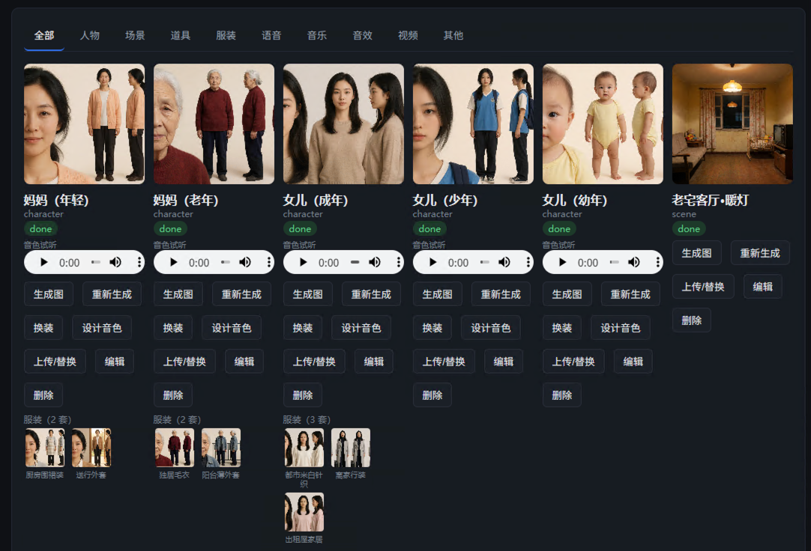
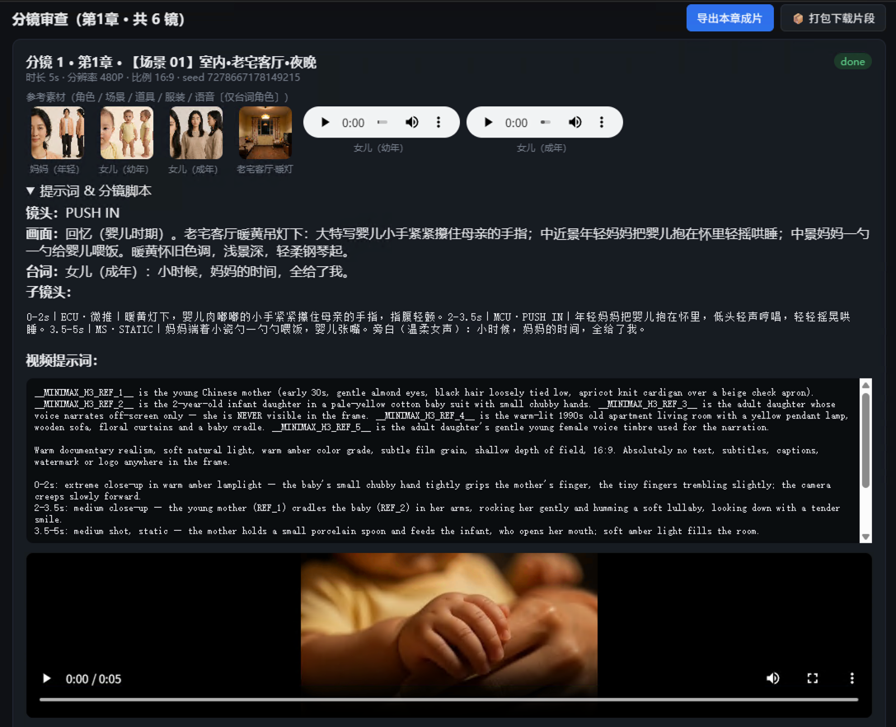
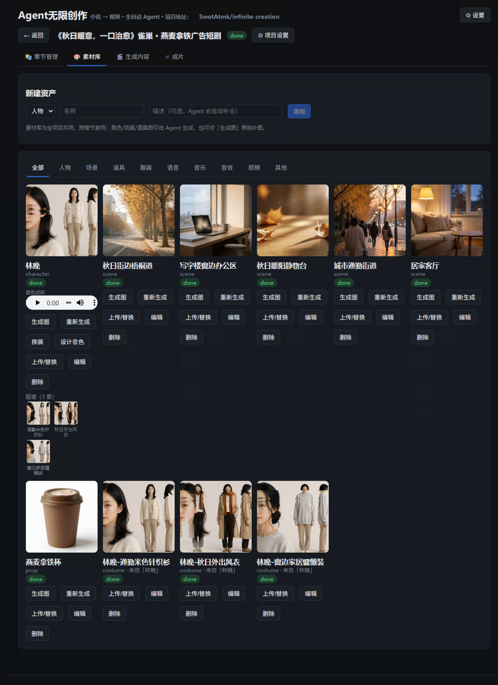
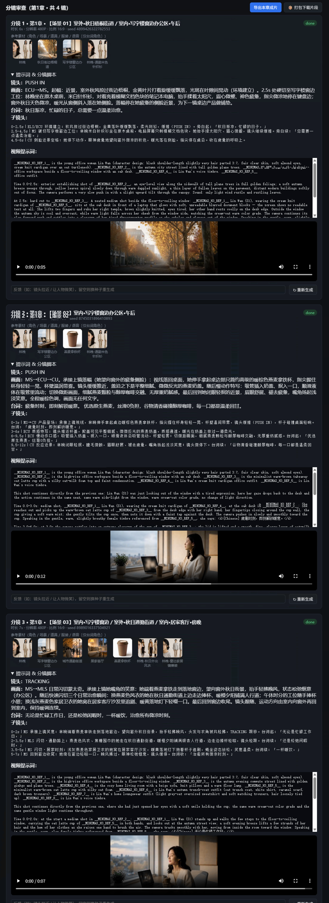
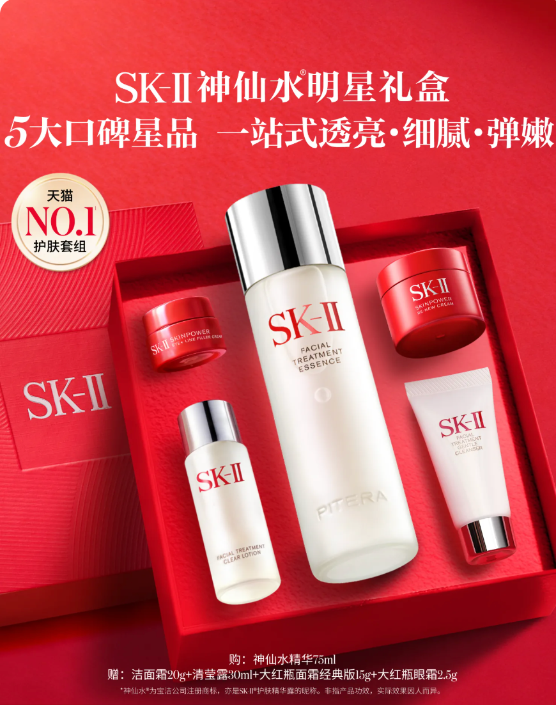

# 运行演示

# 案例一：
## 输入内容
- 项目名称：《妈妈的时间》
- 画面风格：写实
- 章节原文：
```text
镜号	时长	画面	台词 / 旁白	音效
1	0-5s	特写：婴儿小手抓住母亲手指；快速剪辑：妈妈抱孩子、喂饭、深夜哄睡	旁白（温柔女声）：小时候，妈妈的时间，全给了我。	轻柔钢琴
2	5-12s	中景：少年背着书包出门，妈妈站门口挥手；再切：青年离家，妈妈站阳台目送	旁白：我慢慢长大，忙着远行，忙着自己的生活。	钢琴持续，轻微风声
3	12-20s	近景：白发妈妈独自坐在餐桌前，看着空碗筷；手机屏幕亮起，是你的视频通话	旁白：我以为她一直都在。却忘了，她的时间，越来越少。	钢琴转弱，安静
4	20-26s	特写：你拿着手机，笑着喊一声妈；妈妈眼睛瞬间亮起来	旁白：别等太晚，多陪陪她。	音乐渐起
5	26-30s	黑屏出字幕：陪伴，是最好的礼物	（无台词）	音乐收尾
```

## 输出结果
[查看演示视频：../images/妈妈的时间_061bc7e6.mp4](../images/%E5%A6%88%E5%A6%88%E7%9A%84%E6%97%B6%E9%97%B4_061bc7e6.mp4)


## 页面截图
### 素材库


### 分镜审查


------------------------------------------------------------------------

# 案例二：
## 输入内容
- 项目名称：《秋日暖意，一口治愈》燕麦拿铁广告短剧
- 画面风格：写实
- 章节原文：
```text
广告时长：30秒
风格定位：治愈、清新、生活化、秋冬氛围感
核心卖点：0负担植物燕麦、丝滑不腻、暖身治愈、适配日常疲惫时刻
人物：年轻上班族女生（日常简约穿搭，温柔松弛感）
分镜1（0-6s）：氛围感开篇·秋日疲惫
画面：近景，室外秋风拂过街边梧桐，黄叶缓缓飘落，镜头切至写字楼窗边，女生对着电脑揉太阳穴，屏幕满是文档，神色疲惫，指尖微微发凉，窗外天色微凉，光影柔和偏暖。
台词（女声轻缓独白）：秋日渐凉，忙碌的日子，总需要一点温柔治愈。
音效：轻柔秋风声、轻微键盘敲击声、舒缓钢琴前奏
字幕：秋风知凉意，暖心有甜柔
分镜2（7-13s）：产品登场·温暖解锁
画面：特写，女生伸手拿起桌边的新品燕麦拿铁，奶茶杯简约高级，暖棕色调适配秋日。指尖握住杯身，轻微晃动，杯壁温润。镜头拉近，展示平整细腻的奶盖，质感通透。
台词（女声）：疲惫时刻，即刻解锁暖意。
音效：轻微杯子碰撞桌面声、舒缓音乐递进
字幕：雀巢 · 燕麦拿铁 全新上线
分镜3（14-20s）：口感特写·核心卖点
画面：慢动作特写，吸管插入奶盖，抿入一口，顺滑液体流动质感。切换微观画面，细腻燕麦颗粒融合醇厚咖啡，无厚重奶腻感。女生闭眼轻抿，眉眼舒展，褪去疲惫，嘴角扬起浅淡笑意。
台词（女声）：优选原生燕麦，丝滑0负担，谷物清香碰撞醇厚咖啡，每一口都是温柔回甘。
音效：吸管吸食轻响、治愈舒缓背景音乐高潮段
字幕：谷物醇香｜丝滑不腻｜轻负担
分镜4（21-26s）：场景升华·日常适配
画面：中景，女生端着饮品走到窗边，望向窗外秋日街景，抬手轻拂晚风，状态松弛惬意。镜头快速闪切：通勤路上、午休时刻、居家追剧，不同场景下手持燕麦拿铁的治愈瞬间。
台词（女声）：无论是忙碌工作日，还是松弛闲暇时，一杯暖饮，治愈所有微凉时刻。
音效：轻快治愈旋律，氛围温暖松弛
字幕：适配每一个日常瞬间
分镜5（27-30s）：收尾定格·品牌露出
画面：产品全景定格，暖色调滤镜拉满，饮品置于秋日落叶、暖阳背景中，质感高级。画面下方浮现品牌LOGO、产品名称、限时活动标语。
台词（沉稳旁白收尾）：秋日暖心标配，雀巢 · 燕麦拿铁，予你每时每刻的温柔暖意。
音效：音乐轻柔收尾，清脆落音
字幕：雀巢饮品｜温暖相伴 不负秋日
```

## 输出结果
[查看演示视频：../images/秋日暖意_一口治愈_燕麦拿铁广告短剧_2fbee66e.mp4](../images/秋日暖意_一口治愈_燕麦拿铁广告短剧_2fbee66e.mp4)


## 页面截图
### 素材库

### 分镜审查


------------------------------------------------------------------------

# 案例三：漫剧+广告创作类
## 输入内容
- 项目名称：一份懂她的礼物 | SK-II 神仙水明星礼盒
- 画面风格：写实
- 参考图片素材： SK-II护肤礼盒 


- 章节原文：
```text
风格：温情高级、送礼向，适合直播 / 短视频带货
人物：女主（28 岁，精致白领），男主（出镜少）
场景：居家卧室，暖柔光
产品：SK-II 神仙水明星礼盒（75ml 神仙水 + 洁面霜 20g + 清莹露 30ml + 大红瓶面霜 15g + 大红瓶眼霜 2.5g）
镜号	时长	画面	台词	音效 / 字幕
1	0-6s	【近景】女主下班回家，略带疲惫对着镜子摸脸，肤色暗沉粗糙。门口，男主递出红色 SK-II 礼盒，礼盒红盒质感特写	男主（温柔）：辛苦了，给你准备了礼物。	轻柔钢琴 BGM
字幕：最好的礼物，是守护她的光彩
2	6-14s	【特写】女主双手打开红色礼盒，镜头缓缓推进，依次展示 5 大星品：神仙水 C 位，洁面霜、清莹露、大红瓶面霜、眼霜整齐陈列。瓶身反光高级质感	女主（轻声惊喜）：SK-II 神仙水明星礼盒？	礼盒开盖 “咔” 轻响
字幕：天猫 NO.1 护肤套组｜5 大口碑星品
3	14-24s	【蒙太奇快切】
1. 洁面霜起泡，轻柔洁面
2. 清莹露二次擦拭肌肤
3. 神仙水轻拍上脸，PITERA 精华浸润皮肤
4. 大红瓶面霜涂抹，眼霜点涂眼周
女主皮肤慢慢变得透亮细腻，微笑看向镜子	旁白：一套完成全套护肤。PITERA™精华，一站式透亮、细腻、弹嫩，改善粗糙，紧致焕亮。	液体流动轻柔音效
字幕：洁面→清莹露→神仙水→面霜→眼霜
4	24-32s	【面部特写】女主皮肤通透有光泽，自信抬眼，轻轻触摸神仙水瓶身。礼盒全景定格	女主：不用费心搭配，一套全齐，日常护肤刚刚好。送礼自留都很有分量。	BGM 上扬
字幕：购 75ml 神仙水，尊享 4 件明星小样
5	32-35s	【商品主图】SK-II 礼盒全屏展示，弹出商品标题	旁白：SK-II 神仙水明星礼盒，把透亮好肌肤送给她。	字幕：SK-II NO.1 神仙水明星礼盒精华护肤套装礼物
```

## 输出结果
[查看演示视频：../images/一份懂她的礼物_SK-II_神仙水明星礼盒_64b82af4.mp4](../images/%E4%B8%80%E4%BB%BD%E6%87%82%E5%A5%B9%E7%9A%84%E7%A4%BC%E7%89%A9_SK-II_%E7%A5%9E%E4%BB%99%E6%B0%B4%E6%98%8E%E6%98%9F%E7%A4%BC%E7%9B%92_64b82af4.mp4)
